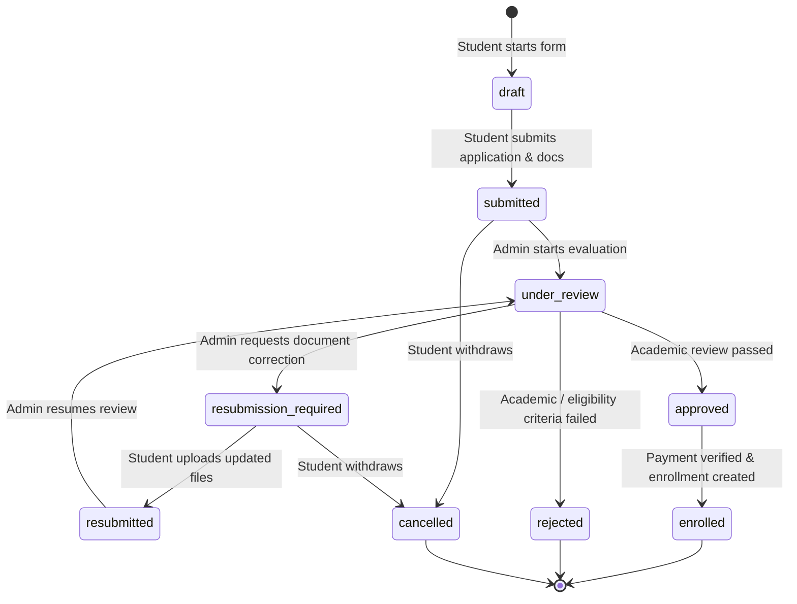

# PathFinder Course Application Management System — Approved Architecture Specification

**Document Version:** 1.7.2
**Status:** Phase 3 Implementation Completed, Staging Preview Verified & Staging End-to-End Enrollment Verified
**Approval Date:** 14 November 2026 (Updated: 18 November 2026)
**Project Repository:** `F:/Project/pathfinder-forge-52`
**Implementation Branch:** `feature/course-application-management`
**Upstream Branching Base Commit:** `0a9d79a95f28942e115bacf10d5166c6441e9267` (`origin/main`, PR #23 merge baseline)
**Verified Preview Commit:** `bed557e4fc160e130944047e21cc307193c9722b` (`origin/feature/course-application-management`, Admin queue applicant identity display)
**Production Authorization Notice:** Production database migrations, Supabase schema modifications, and deployment changes have **NOT** yet been executed or authorized. This document records approved architectural decisions and specifications for development within the permanent repository `F:/Project/pathfinder-forge-52` (branch: `feature/course-application-management`).

---

## 1. Approved Business Decisions (14 November 2026)

The following five architectural and business decisions were formally approved by project leadership on 14 November 2026 and govern all implementation work in this repository:

| Decision ID | Domain | Approved Policy & Specification | Status |
| :--- | :--- | :--- | :--- |
| **DEC-01** | **Course IDs & Relational Architecture** | **Keep `public.courses.id` as `TEXT`.** Do not migrate the column to `UUID`. Avoid destructive schema alterations on existing course rows. In new tables (`course_applications`), store `course_id` as `UUID` and validate references against `public.courses(id::text)` using database constraints/triggers. | **APPROVED** |
| **DEC-02** | **Student Identity & Guest Submissions** | **Allow guest (unauthenticated) applications.** Prospective students may submit applications prior to creating a user account. Applications can later be claimed after account creation using cryptographic verification of email ownership via `auth.users.email_confirmed_at` and single-use claim token hashes with expiration. | **APPROVED** |
| **DEC-03** | **Review & Payment Sequencing** | **Academic evaluation occurs first; payment verification is required before enrollment activation.** Applications are vetted academically (`submitted` $\to$ `under_review` $\to$ `approved`). Actual enrollment in `public.enrollments_users` occurs only when payment verification is satisfied (`verified`, `waived`, or `not_required`). | **APPROVED** |
| **DEC-04** | **Document Upload Limits** | **Maximum file size is 10 MB per file.** Accepted formats are strictly `application/pdf`, `image/jpeg`, and `image/png`. Enforce binary magic-byte inspection before storage commit. | **APPROVED** |
| **DEC-05** | **Data Retention & Privacy** | **Approved applications:** Retain for 5 years for academic accreditation and verification.<br/>**Rejected applications:** Retain for 1 year for reapplication context and fraud prevention.<br/>**Personal Identity Documents:** Retain for 180 days post-decision for privacy compliance.<br/>**Audit Logs:** Retain permanently for regulatory compliance. | **APPROVED** |

---

## 2. System Domain Separation

The Course Application Management System cleanly separates candidate evaluation from operational course access:

```mermaid
flowchart LR
    subgraph AppDomain["1. Application Domain (Evaluation & Processing)"]
        CA["public.course_applications"]
        CAD["public.course_application_documents"]
        CAE["public.course_application_events"]
        CAL["public.course_application_audit_logs"]
        NO["public.notification_outbox"]
    end

    subgraph EnrollDomain["2. Enrollment Domain (Operational Access)"]
        EU["public.enrollments_users<br/>(Active Operational Table)"]
        LE["public.enrollments<br/>(Legacy Table - Preserved)"]
    end

    CA -->|Academic Approval + Payment Verified| RPC[approve_course_application_and_enroll]
    RPC -->|Atomic Materialization (Advisory Locked)| EU
```

1. **Application Domain (`course_applications`, `course_application_documents`, `course_application_events`, `course_application_audit_logs`, `notification_outbox`):** Governs candidate vetting, academic background, document verification, timeline tracking, regulatory auditing, and transactional asynchronous notifications.
2. **Enrollment Domain (`enrollments_users`):** Governs student dashboard access, course material unlocking, and counselor WhatsApp routing. Entries are created in `enrollments_users` **only** upon final enrollment activation.

---

## 3. Application Lifecycle State Machine



### State Definitions
- **`draft`:** Student initialized an application but has not finalized submission.
- **`submitted`:** Application finalized and queued for administrator review.
- **`under_review`:** Administrator assigned and actively reviewing academic criteria.
- **`resubmission_required`:** Administrator identified an invalid/illegible document; student notified.
- **`resubmitted`:** Student uploaded replacement documents; re-entered review queue.
- **`approved`:** Academic criteria met. Awaiting payment verification (if fee-based).
- **`enrolled`:** Terminal positive state. Atomic enrollment created in `public.enrollments_users`.
- **`rejected`:** Terminal negative state. Academic criteria or capacity limits not met.
- **`cancelled`:** Student voluntarily withdrew prior to enrollment.

---

## 4. Payment Workflow Specifications

Payment rules differ by course and applicant:
1. **Fee-Free Courses:** Application automatically assigned `payment_status = 'not_required'`.
2. **Scholarships / Waivers:** Administrator assigns `payment_status = 'waived'` with audit notes.
3. **Fee-Based Courses:** Application assigned `payment_status = 'unpaid'`. Upon student payment proof submission, status advances to `'pending_verification'`.
4. **Verification:** Administrator cross-references payment reference (UTR / transaction ID) and moves status to `'verified'`.
5. **Precondition for Enrollment:** Both the atomic approval RPC and the table-level check constraint enforce:
   `status != 'enrolled' OR payment_status IN ('verified', 'waived', 'not_required')`.

---

## 5. Database Schema Specifications

### 5.1 `public.course_applications`
```sql
CREATE SEQUENCE IF NOT EXISTS public.course_application_number_seq START 1;

CREATE TABLE public.course_applications (
    id UUID PRIMARY KEY DEFAULT gen_random_uuid(),
    application_number TEXT UNIQUE NOT NULL DEFAULT public.generate_course_application_number(),
    user_id UUID REFERENCES auth.users(id) ON DELETE SET NULL, -- Nullable for guest submissions (DEC-02)
    guest_claim_token_hash TEXT NULL, -- Cryptographic hash of single-use claiming token
    guest_claim_token_expires_at TIMESTAMPTZ NULL, -- Expiration timestamp for guest claim token (7-day default TTL)
    course_id UUID NOT NULL, -- Validated via trigger against public.courses(id::text) (DEC-01)
    student_name TEXT NOT NULL,
    student_email TEXT NOT NULL,
    student_phone TEXT,
    academic_background JSONB NOT NULL DEFAULT '{}'::jsonb,
    statement_of_purpose TEXT,
    status TEXT NOT NULL DEFAULT 'submitted' CHECK (
        status IN (
            'draft',
            'submitted',
            'under_review',
            'resubmission_required',
            'resubmitted',
            'approved',
            'enrolled',
            'rejected',
            'cancelled',
            'revoked',
            'suspended'
        )
    ),
    payment_status TEXT NOT NULL DEFAULT 'unpaid' CHECK (
        payment_status IN ('not_required', 'unpaid', 'pending_verification', 'verified', 'waived', 'refunded', 'disputed')
    ),
    payment_reference TEXT,
    payment_amount_inr NUMERIC(10, 2),
    assigned_admin_id UUID REFERENCES auth.users(id) ON DELETE SET NULL,
    enrollment_id UUID REFERENCES public.enrollments_users(id) ON DELETE SET NULL,
    rejection_reason TEXT,
    resubmission_notes TEXT,
    submitted_at TIMESTAMPTZ DEFAULT now(),
    approved_at TIMESTAMPTZ,
    rejected_at TIMESTAMPTZ,
    created_at TIMESTAMPTZ DEFAULT now() NOT NULL,
    updated_at TIMESTAMPTZ DEFAULT now() NOT NULL,

    -- Defense-in-depth: Enforce lifecycle separation (DEC-03)
    CONSTRAINT chk_course_applications_enrolled_payment CHECK (
        status != 'enrolled' OR payment_status IN ('verified', 'waived', 'not_required')
    )
);

CREATE INDEX idx_course_applications_email ON public.course_applications (lower(trim(student_email)));
CREATE INDEX idx_course_applications_user_id ON public.course_applications (user_id);
CREATE INDEX idx_course_applications_guest_claim ON public.course_applications (guest_claim_token_hash, guest_claim_token_expires_at) WHERE guest_claim_token_hash IS NOT NULL;
CREATE INDEX idx_course_applications_course_id ON public.course_applications (course_id);
CREATE INDEX idx_course_applications_status ON public.course_applications (status);
```

### 5.2 Application-Number Generation Specification
The agreed application-number format across schema and architecture is:
```text
APP-YYYY-00001
```
- **Generator Function:** `public.generate_course_application_number()`
- **Sequence:** `public.course_application_number_seq` starting at 1.
- **Components:**
  1. Static prefix `APP-`
  2. Four-digit UTC year string `TO_CHAR(timezone('utc'::text, now()), 'YYYY')`
  3. Hyphen `-`
  4. Sequence number zero-padded to 5 digits via `LPAD(NEXTVAL(...)::TEXT, 5, '0')`
- **Distinction on Timezone Handling:** Converting `now()` to UTC timestamp for string extraction in `TO_CHAR` is deliberate for year extraction, whereas column timestamps default natively to `now()` (`TIMESTAMPTZ`).

### 5.3 Course Referential Integrity & Deletion Protection (DEC-01)
To protect references without altering the `public.courses.id` type from TEXT:
1. **Application-side Validation Trigger (`trg_validate_course_application_course_id`):**
   - Validates that `NEW.course_id::text` exists in `public.courses`.
   - Acquires `FOR KEY SHARE` row lock to guard against concurrent course deletion or mutation during application insertion.
   - Configured with `SECURITY DEFINER` and `SET search_path = pg_catalog, public, pg_temp` to allow guest submissions even if caller lacks direct SELECT rights on courses.
   - **SECURITY DEFINER & Precise RLS Boundary Semantics:**
     - A `SECURITY DEFINER` function executes with the privileges of its owning role rather than the calling role.
     - `SECURITY DEFINER` does **not** automatically bypass Row Level Security (RLS).
     - RLS on `public.courses` is bypassed only if:
       1. The owning role possesses the PostgreSQL `BYPASSRLS` role attribute, OR
       2. The owning role is a PostgreSQL superuser, OR
       3. The owning role is the table owner of `public.courses` AND `FORCE ROW LEVEL SECURITY` is **not** enabled on `public.courses`.
     - **FORCE ROW LEVEL SECURITY Behavior & Boundaries:**
       - When `FORCE ROW LEVEL SECURITY` is enabled on `public.courses`, a table owner that does not otherwise bypass RLS becomes subject to RLS.
       - `FORCE ROW LEVEL SECURITY` does **not** override the `BYPASSRLS` attribute or superuser bypass (superusers and roles with `BYPASSRLS` remain exempt from RLS regardless of `FORCE RLS`).
     - A role without `BYPASSRLS` that is neither a superuser nor an exempt table owner remains subject to applicable RLS policies on `public.courses`, which evaluate and govern row visibility.
     - In all cases, required underlying table privileges (`SELECT` on `public.courses` for the referential query) must strictly exist.
     - Production function ownership, role attributes (`BYPASSRLS`), table-level grants, and live `FORCE ROW LEVEL SECURITY` configuration on `public.courses` have **not** been inspected or verified and remain mandatory implementation prerequisites to be confirmed during Phase 3.4.
   - Execution revoked from `PUBLIC` (`REVOKE EXECUTE ON FUNCTION public.validate_course_application_course_id() FROM PUBLIC;`).
2. **Course-side Protection Trigger (`trg_prevent_course_deletion_or_id_change`):**
   - Fires `BEFORE UPDATE OF id OR DELETE ON public.courses`.
   - Forbids deletion or ID modification if any record in `public.course_applications` references the course.
   - Enforces the business rule that courses should be retired or archived rather than deleted once applications exist.
   - Execution revoked from `PUBLIC` (`REVOKE EXECUTE ON FUNCTION public.prevent_referenced_course_deletion_or_id_change() FROM PUBLIC;`).

### 5.4 `public.course_application_documents`
```sql
CREATE TABLE public.course_application_documents (
    id UUID PRIMARY KEY DEFAULT gen_random_uuid(),
    application_id UUID NOT NULL REFERENCES public.course_applications(id) ON DELETE CASCADE,
    document_type TEXT NOT NULL CHECK (
        document_type IN ('resume', 'academic_transcript', 'id_proof', 'payment_proof', 'other')
    ),
    file_name TEXT NOT NULL,
    file_size_bytes BIGINT NOT NULL CHECK (file_size_bytes > 0 AND file_size_bytes <= 10485760),
    mime_type TEXT NOT NULL CHECK (mime_type IN ('application/pdf', 'image/jpeg', 'image/png')),
    storage_path TEXT UNIQUE NOT NULL,
    sha256_hash TEXT,
    is_archived BOOLEAN NOT NULL DEFAULT false,
    archived_at TIMESTAMPTZ,
    created_at TIMESTAMPTZ DEFAULT now() NOT NULL
);

CREATE INDEX idx_app_documents_app_id ON public.course_application_documents (application_id);
CREATE INDEX idx_app_documents_type ON public.course_application_documents (application_id, document_type) WHERE is_archived = false;
```

### 5.5 `public.course_application_events` (User-Facing Progress Timeline)
```sql
CREATE TABLE public.course_application_events (
    id BIGSERIAL PRIMARY KEY,
    application_id UUID NOT NULL REFERENCES public.course_applications(id) ON DELETE CASCADE,
    event_type TEXT NOT NULL CHECK (
        event_type IN (
            'DRAFT_CREATED',
            'SUBMITTED',
            'UNDER_REVIEW',
            'RESUBMISSION_REQUESTED',
            'RESUBMITTED',
            'APPROVED',
            'PAYMENT_VERIFIED',
            'ENROLLED',
            'REJECTED',
            'CANCELLED',
            'CLAIMED_BY_USER',
            'REVOKED'
        )
    ),
    actor_type TEXT NOT NULL CHECK (actor_type IN ('student', 'admin', 'system')),
    actor_id UUID REFERENCES auth.users(id) ON DELETE SET NULL,
    title TEXT NOT NULL,
    description TEXT,
    metadata JSONB NOT NULL DEFAULT '{}'::jsonb,
    created_at TIMESTAMPTZ DEFAULT now() NOT NULL
);

CREATE INDEX idx_app_events_app_id ON public.course_application_events (application_id, created_at DESC);
```
- **Purpose:** Provides a candidate-accessible timeline of application status transitions, administrative review requests, and milestone achievements.
- **Cascade Behavior:** Unlike audit logs, event timeline records belong to the student dossier life cycle and cascade delete with the application.

### 5.6 `public.course_application_audit_logs` (Immutability Architecture)
```sql
CREATE TABLE public.course_application_audit_logs (
    id BIGSERIAL PRIMARY KEY,
    application_id UUID REFERENCES public.course_applications(id) ON DELETE SET NULL,
    actor_id UUID REFERENCES auth.users(id) ON DELETE SET NULL,
    actor_role TEXT NOT NULL CHECK (actor_role IN ('admin', 'student', 'system', 'service_role')),
    action TEXT NOT NULL,
    previous_state JSONB,
    new_state JSONB,
    notes TEXT,
    ip_address INET,
    user_agent TEXT,
    created_at TIMESTAMPTZ DEFAULT now() NOT NULL
);

CREATE INDEX idx_app_audit_app_id ON public.course_application_audit_logs (application_id);
CREATE INDEX idx_app_audit_created_at ON public.course_application_audit_logs (created_at DESC);

-- Immutability enforcement
REVOKE UPDATE, DELETE, TRUNCATE ON public.course_application_audit_logs FROM PUBLIC, anon, authenticated;
```
- **Immutability Triggers:** Row-level triggers reject `UPDATE` and `DELETE`, and a statement-level trigger rejects `TRUNCATE`.
- **Operational Boundary:** Protects against application and client roles. Does not prevent PostgreSQL superusers (`postgres` / `supabase_admin`) from modifying tables or disabling triggers.
- **Audit Isolation:** Note that audit log mutation protection applies *strictly* to `course_application_audit_logs` and provides zero security or access restriction for any other table in the schema.

### 5.7 `public.notification_outbox`
```sql
CREATE TABLE public.notification_outbox (
    id BIGSERIAL PRIMARY KEY,
    application_id UUID REFERENCES public.course_applications(id) ON DELETE SET NULL,
    recipient_email TEXT NOT NULL,
    template_name TEXT NOT NULL CHECK (
        template_name IN (
            'application_received',
            'review_started',
            'resubmission_required',
            'application_approved',
            'application_rejected',
            'enrollment_confirmed',
            'enrollment_revoked'
        )
    ),
    payload JSONB NOT NULL DEFAULT '{}'::jsonb,
    idempotency_key TEXT UNIQUE NOT NULL,
    status TEXT NOT NULL DEFAULT 'pending' CHECK (status IN ('pending', 'processing', 'sent', 'failed', 'dead_letter')),
    attempts INTEGER NOT NULL DEFAULT 0,
    max_attempts INTEGER NOT NULL DEFAULT 5,
    locked_until TIMESTAMPTZ,
    last_error TEXT,
    next_attempt_at TIMESTAMPTZ DEFAULT now() NOT NULL,
    sent_at TIMESTAMPTZ,
    created_at TIMESTAMPTZ DEFAULT now() NOT NULL
);

CREATE INDEX idx_notification_outbox_queue ON public.notification_outbox (next_attempt_at, locked_until)
WHERE status IN ('pending', 'failed');

CREATE INDEX idx_notification_outbox_locked ON public.notification_outbox (locked_until)
WHERE status = 'processing';
```

### 5.8 Indexing Strategy & Schema Additions Rationale
The schema includes 14 secondary indexes designed to support specific access paths and operational query patterns:
1. `idx_course_applications_email`: Supports case-insensitive email dossier lookups (`lower(trim(student_email))`).
2. `idx_course_applications_user_id`: Supports candidate dashboard queries filtering by linked user account.
3. `idx_course_applications_guest_claim`: Filtered index supporting guest token claiming lookups (`guest_claim_token_hash IS NOT NULL`).
4. `idx_course_applications_course_id`: Supports administrative filtering of applications by course.
5. `idx_course_applications_status`: Optimizes administrative pipeline queries filtering by application lifecycle status.
6. `idx_course_applications_created_at`: Supports index-ordered chronological review queues (`created_at DESC`).
7. `idx_unique_payment_ref`: Conditional unique index preventing duplicate payment reference submissions across active non-refunded applications.
8. `idx_app_documents_app_id`: Supports retrieval of documents attached to a specific application ID.
9. `idx_app_documents_type`: Filtered composite index (`application_id, document_type WHERE is_archived = false`) supporting selective lookups of active candidate documents when superseded drafts exist.
10. `idx_app_events_app_id`: Supports ordered candidate timeline event queries (`application_id, created_at DESC`).
11. `idx_app_audit_app_id`: Supports retrieval of audit trail entries by application ID.
12. `idx_app_audit_created_at`: Supports chronological sorting and time-window filtering for compliance audits.
13. `idx_notification_outbox_queue`: Partial composite index on `(next_attempt_at, locked_until) WHERE status IN ('pending', 'failed')` tailored to worker polling query patterns.
14. `idx_notification_outbox_locked`: Partial index on `(locked_until) WHERE status = 'processing'` supporting efficient recovery queries for stalled worker leases.

> [!NOTE]
> **Query Planner & Performance Reality:**
> While these indexes are engineered to provide efficient access paths for their respective workload queries, PostgreSQL's cost-based query planner ultimately decides between an index scan, bitmap index scan, or sequential scan based on table cardinality, page statistics, and predicate selectivity. Indexes do not categorically eliminate sequential scans across all execution contexts (such as small initial table volumes or non-selective queries).

---

## 6. Concurrency, Advisory Locks & Idempotent Approval

### Crucial Relational Facts
1. Production table `public.enrollments_users` has **NO unique constraint** on `(student_email, course_id)`. Therefore, PostgreSQL `INSERT ... ON CONFLICT (student_email, course_id)` is **invalid** and aborts at runtime.
2. Production table `public.enrollments_users` does **not** have an enrollment status column.
3. Arbitrary selection of existing enrollment records via `LIMIT 1` or aggregate functions (e.g. `MIN(id)`) on UUID columns is strictly unsafe and invalid architectural design.
4. Two separate SQL queries (e.g., `SELECT count(*)` followed by `SELECT id`) can observe different snapshots under default `READ COMMITTED` isolation if concurrent writers commit between them.

### Approved Concurrency & Snapshot-Consistent Deduplication Architecture
To establish a coordinated, snapshot-consistent protocol for idempotent enrollment creation without modifying existing tables or suffering from snapshot skew:

> [!NOTE]
> **Advisory Lock Boundary & Cooperative Scope:**
> This protocol serializes concurrent executions among **cooperating writers** that participate in this exact approval workflow using the `(hashtext(email), hashtext(course_id))` locking protocol. It does **not** provide absolute database-level mathematical uniqueness against uncoordinated legacy writers, manual administrative database inserts, or external integrations that write directly to `public.enrollments_users` without acquiring this advisory lock. True relational uniqueness requires an explicit database unique constraint or unique index on `(lower(trim(student_email)), course_id)`. Such a constraint requires an authorized production deduplication audit before creation.
1. **Application Dossier Row Lock:**
   `SELECT * FROM public.course_applications WHERE id = p_application_id FOR UPDATE;`
2. **Dual-Key Transaction Advisory Lock:**
   Acquire an advisory lock scoped to the transaction using two independent 32-bit hash namespaces (normalized email and course_id):
   ```sql
   PERFORM pg_advisory_xact_lock(
       hashtext(lower(trim(v_app.student_email))),
       hashtext(v_app.course_id::text)
   );
   ```
3. **Single Snapshot-Consistent Deduplication & Safe Collision Handling (Inside Lock):**
   ```sql
   -- 1. Single snapshot query: obtain match count and candidate UUID from identical statement snapshot
   SELECT count(*), (array_agg(id))[1]
   INTO v_match_count, v_candidate_id
   FROM public.enrollments_users
   WHERE lower(trim(student_email)) = lower(trim(v_app.student_email))
     AND course_id = v_app.course_id;

   IF v_match_count = 1 THEN
       -- 2. Exactly one record exists in this snapshot: reuse its UUID safely
       v_enrollment_id := v_candidate_id;

   ELSIF v_match_count > 1 THEN
       -- 3. Multiple conflicting records detected in this snapshot: fail safely and require reconciliation
       RAISE EXCEPTION 'Multiple conflicting enrollment records (%) found for student % and course %. Manual administrative reconciliation required.',
           v_match_count, v_app.student_email, v_app.course_id
           USING ERRCODE = 'data_exception';

   ELSE
       -- 4. Exactly zero existing enrollments: insert new record safely under transaction advisory lock
       INSERT INTO public.enrollments_users (
           student_name,
           student_email,
           course_id,
           enrollment_date
       ) VALUES (
           v_app.student_name,
           lower(trim(v_app.student_email)),
           v_app.course_id,
           now()
       )
       RETURNING id INTO v_enrollment_id;
   END IF;
   ```
4. **Link Application:** Set `course_applications.enrollment_id = v_enrollment_id` and `status = 'enrolled'`.
5. **Idempotent Return:** If the RPC is called again for an already-enrolled application, it immediately returns the existing enrollment ID without modifying anything.
6. **Future Audit Requirement:** Prior to introducing any database-level unique constraint on `(student_email, course_id)`, an authorized read-only deduplication audit must be conducted on production `enrollments_users`.

### Explicit Concurrency Limitation & Boundary
> [!IMPORTANT]
> **Advisory Lock Boundary Limitation:**
> The transaction-scoped advisory lock (`pg_advisory_xact_lock`) coordinates **only** cooperative writers that execute within this approved application approval workflow using the identical `(hashtext(email), hashtext(course_id))` key protocol.
> It does **not** block or serialize uncoordinated legacy processes, manual administrative database inserts, or external integrations that write directly to `public.enrollments_users` without acquiring this advisory lock.
> Therefore, this mechanism does **not** provide an absolute database-level mathematical uniqueness guarantee. True relational uniqueness requires an explicit database unique constraint or unique index on `(lower(trim(student_email)), course_id)`. Such a constraint cannot be safely introduced until an authorized read-only deduplication audit of existing production `enrollments_users` data is conducted in Phase 3.4.

---

## 7. Student Identity & Guest Claiming Security (DEC-02)

### Complete Mandatory Claim Authorization Conditions
A guest application claim operation must strictly enforce **ALL** eleven of the following criteria in a single atomic transaction:
1. **Unassigned Target:** `user_id IS NULL` on `course_applications`.
2. **Token Hash Present:** `guest_claim_token_hash IS NOT NULL`.
3. **Cryptographic Hash Match:** The SHA-256 hash of the supplied plaintext token matches `guest_claim_token_hash` byte-for-byte.
4. **Token Expiration Present:** `guest_claim_token_expires_at IS NOT NULL`.
5. **Not Expired:** `guest_claim_token_expires_at > now()`.
6. **Authenticated Session:** Caller must be authenticated (`auth.uid() IS NOT NULL`).
7. **Verified Account Email:** Authenticated user account must be email-verified (`auth.users.email_confirmed_at IS NOT NULL`).
8. **Email Ownership Match:** Normalized authenticated account email matches normalized application email:
   `lower(trim(auth.users.email)) = lower(trim(course_applications.student_email))`.
9. **Atomic Execution:** Claiming must execute inside a database transaction with row-level locks.
10. **Token Invalidation on Consumption:** Successful claiming atomically sets **both** `guest_claim_token_hash = NULL` and `guest_claim_token_expires_at = NULL`.
11. **Anti-Hijacking Invariant:** An application with `user_id IS NOT NULL` can never be claimed or reassigned under any circumstances.

> [!CAUTION]
> **Security Invariant:** Never permit claiming merely because `guest_claim_token_hash IS NULL`. An unlinked application without a valid, unexpired claim token must request a new token via verified email dispatch.
> **Identity Verification Rule:** Never use a caller-supplied email parameter as proof of ownership. The email must be retrieved directly from `auth.users` using `auth.uid()`.

### Token Generation, Delivery & Security Rules
- **Entropy:** Server generates a cryptographically secure random token (CSPRNG, $\ge 32$ bytes of entropy, URL-safe base64/hex).
- **Default TTL:** **7 days (168 hours)** from generation timestamp across all system services.
- **Hash-Only Storage:** Only `sha256(token)` is persisted into `guest_claim_token_hash`. Plaintext tokens are never stored, logged, or exposed in API responses.
- **Single-Use:** Token cannot be reused after consumption.
- **Enumeration Defense:** The claim endpoint must return a generic response upon token failure or mismatched email, preventing bad actors from verifying whether an application exists for an arbitrary email.

### Illustrative Architectural Pattern for Future Claim RPC
*(Conceptual architecture example: Illustrates transactional security requirements; not executed against any database in this phase).*
```sql
CREATE OR REPLACE FUNCTION public.claim_guest_course_application(
    p_application_id UUID,
    p_plain_token TEXT
)
RETURNS BOOLEAN
LANGUAGE plpgsql
SECURITY DEFINER
SET search_path = pg_catalog, public, pg_temp
AS $$
DECLARE
    v_caller_id UUID;
    v_auth_email TEXT;
    v_email_confirmed_at TIMESTAMPTZ;
    v_supplied_token_hash TEXT;
    v_claimed_app_id UUID;
BEGIN
    -- 1. Obtain authenticated caller identity directly from context
    v_caller_id := auth.uid();
    IF v_caller_id IS NULL THEN
        RAISE EXCEPTION 'Authentication required.' USING ERRCODE = 'insufficient_privilege';
    END IF;

    -- 2. Authoritatively retrieve verified email directly from auth.users (never trust caller input)
    SELECT email, email_confirmed_at
    INTO v_auth_email, v_email_confirmed_at
    FROM auth.users
    WHERE id = v_caller_id;

    IF v_auth_email IS NULL OR v_email_confirmed_at IS NULL THEN
        -- Account exists but email is unconfirmed or null
        RAISE EXCEPTION 'Email confirmation required before claiming applications.'
            USING ERRCODE = 'insufficient_privilege';
    END IF;

    -- 3. Derive cryptographic SHA-256 hash from caller-supplied plaintext token
    -- Note on extension schema: digest() is provided by the pgcrypto extension.
    -- In Supabase, pgcrypto is typically installed in schema 'extensions' or 'public'.
    -- The exact schema has not been verified against production and must be confirmed prior to implementation.
    v_supplied_token_hash := encode(digest(p_plain_token, 'sha256'), 'hex');

    -- 4. Atomically lock and claim the application dossier
    -- Enforces all 11 security conditions:
    -- - Unlinked (user_id IS NULL)
    -- - Active token hash present (guest_claim_token_hash IS NOT NULL)
    -- - Exact cryptographic hash match
    -- - Expiry timestamp present and valid (guest_claim_token_expires_at > now())
    -- - Verified email ownership match (normalized)
    -- - Locks target row FOR UPDATE
    UPDATE public.course_applications
    SET user_id = v_caller_id,
        guest_claim_token_hash = NULL,
        guest_claim_token_expires_at = NULL,
        updated_at = now()
    WHERE id = p_application_id
      AND user_id IS NULL
      AND guest_claim_token_hash IS NOT NULL
      AND guest_claim_token_hash = v_supplied_token_hash
      AND guest_claim_token_expires_at IS NOT NULL
      AND guest_claim_token_expires_at > now()
      AND lower(trim(student_email)) = lower(trim(v_auth_email))
    RETURNING id INTO v_claimed_app_id;

    -- 5. Anti-Enumeration & Failure Handling:
    -- If no row matched or updated, return generic failure without revealing whether
    -- the application ID exists, belongs to another student, or had an expired token.
    IF v_claimed_app_id IS NULL THEN
        RAISE EXCEPTION 'Invalid claim request or expired token.'
            USING ERRCODE = 'invalid_parameter_value';
    END IF;

    -- 6. Record immutable compliance audit entry
    INSERT INTO public.course_application_audit_logs (
        application_id, actor_id, actor_role, action, notes
    ) VALUES (
        v_claimed_app_id,
        v_caller_id,
        'student',
        'APPLICATION_CLAIMED_BY_ACCOUNT',
        'Linked unauthenticated guest application to verified account via single-use claim token'
    );

    RETURN TRUE;
END;
$$;

-- Explicit Least-Privilege Execution Policy (Conceptual Draft):
REVOKE EXECUTE ON FUNCTION public.claim_guest_course_application(UUID, TEXT) FROM PUBLIC;
REVOKE EXECUTE ON FUNCTION public.claim_guest_course_application(UUID, TEXT) FROM anon;
GRANT EXECUTE ON FUNCTION public.claim_guest_course_application(UUID, TEXT) TO authenticated;
```

### Least-Privilege Execution & Security Boundary Documentation
1. **Explicit Role Grants:**
   - Default execution is revoked from `PUBLIC` and `anon`.
   - Execution is granted strictly to the `authenticated` role, ensuring only authenticated users with valid JWTs can invoke the endpoint.
2. **`SECURITY DEFINER` Rationale & Ownership:**
   - Elevated execution is strictly required so that the function can read `auth.users` to verify the caller's confirmed email, bypassing the restriction where client roles cannot read administrative auth tables under RLS.
   - It also performs atomic state transitions across `public.course_applications` and `public.course_application_audit_logs`.
   - **Trusted Owner Assumption:** Requires execution under a trusted database role (such as `postgres` or `supabase_admin`) possessing appropriate table privileges. The live production owner and ACLs have **not** been verified in this read-only phase.
3. **`digest()` Extension-Schema Unresolved Assumption:**
   - The illustrative claim function calls `digest()`, which is provided by PostgreSQL's `pgcrypto` extension.
   - A search of repository SQL files confirmed that no extension installation scripts exist in this codebase.
   - In standard Supabase environments, `pgcrypto` is installed in schema `extensions` (or occasionally `public`).
   - The exact schema of `pgcrypto` is **unverified**. When implementing the RPC in Phase 3.4/3.5, administrators must verify the extension's schema (e.g., `extensions.digest(...)` vs `public.digest(...)`, or ensuring `extensions` is present in the function's `search_path`).

---

## 8. Row Level Security (RLS) & Table Access Policy Architecture (Pre-Deployment Requirement)

> [!CAUTION]
> **CRITICAL SECURITY NOTICE — PRODUCTION DEPLOYMENT BLOCKER:**
> The current schema migration draft (`supabase_course_applications_schema_v1.sql`) defines table structures, constraints, sequences, triggers, and performance indexes, but **does NOT yet enable Row Level Security (RLS) or define access policies**.
> **Production deployment is strictly BLOCKED** until formal RLS policies and table grant/revoke permissions are designed, reviewed, and approved for all five application tables:
> 1. `public.course_applications`
> 2. `public.course_application_documents`
> 3. `public.course_application_events`
> 4. `public.course_application_audit_logs`
> 5. `public.notification_outbox`

### 8.1 Privilege Architecture, Default Grants & RLS Deny-By-Default
To accurately evaluate the security model, four distinct database layers must be distinguished:

1. **PostgreSQL Standard Table Privileges:**
   In core PostgreSQL, newly created tables grant all permissions (`ALL`) exclusively to the creating table owner. Other roles have zero access unless granted explicitly or via schema-level default privileges.
2. **Supabase Default Privileges (`ALTER DEFAULT PRIVILEGES`):**
   In standard Supabase environments, initial setup routines often configure default privileges in `public` via `ALTER DEFAULT PRIVILEGES ... GRANT ALL ON TABLES TO anon, authenticated, service_role`. When present, this causes newly created tables to automatically inherit permissions for API roles. However, default privileges can be customized or restricted per project.
3. **RLS Policy Enforcement Layer:**
   Table privileges operate as the initial gate. If table privileges exist, enabling Row Level Security activates row-by-row filtering. Executing `ALTER TABLE <table_name> ENABLE ROW LEVEL SECURITY;` without defining permissive policies enforces a strict **deny-by-default** rule for non-superusers (`anon`, `authenticated`), causing direct client PostgREST queries to fail with HTTP 401/403.
4. **Unverified Live Project ACL Configuration:**
   Because Phase 3.3.x is strictly local and read-only, the production Supabase instance's live default privileges, role grants, schema-level ACLs, and table-level ownership have **not** been freshly inspected.
   - The five Course Application tables have **not been deployed** to production, and production does not currently expose them.
   - Production deployment is strictly **BLOCKED** until live default privileges and ACLs are audited, and explicit least-privilege table grants/revocations and RLS policies are designed and approved.

### 8.2 Three Distinct Architectural Access Tiers
The security architecture must enforce strict separation across three operational contexts:

1. **Tier 1: Authenticated Client Access (`authenticated` role):**
   - **Enrolled / Prospective Students:**
     - `course_applications`: Permitted to `SELECT` only their own dossiers where `user_id = auth.uid()`. Direct client `UPDATE` or `DELETE` is prohibited. Status changes must be mediated by validated workflows.
     - `course_application_documents`: Permitted to `SELECT` and `INSERT` metadata for documents attached to applications they own (`application_id IN (SELECT id FROM course_applications WHERE user_id = auth.uid())`).
     - `course_application_events`: Permitted to `SELECT` milestone timeline events where `application_id` belongs to them. `INSERT`, `UPDATE`, `DELETE` are prohibited.
   - **Admins & Reviewers:**
     - Permitted to `SELECT` all applications or assigned applications, `UPDATE` review statuses/notes, and `INSERT` timeline events, gated strictly by verified administrative role checking (`public.profile.role = 'admin'` or JWT claims). Direct tampering with payment or audit logs remains prohibited.

2. **Tier 2: Anonymous Guest Submissions (`anon` role):**
   - **DEC-02 Compliance:** Allows prospective candidates to apply before registering (`user_id IS NULL`).
   - **Direct Table Access Forbidden:** Granting unauthenticated `anon` direct `INSERT` or `SELECT` rights on `public.course_applications` creates unacceptable risks of database poisoning, spam flooding, and PII harvesting.
   - **Server-Side API / Hardened RPC Mediation:** Guest applications and document uploads must be submitted through a rate-limited, validated server endpoint or a hardened `SECURITY DEFINER` RPC (`submit_guest_application`). Direct `anon` table access via Supabase PostgREST must remain denied.

3. **Tier 3: Trusted Server-Side Operations (`service_role` & Background Workers):**
   - **Notification Worker:** Background process running on TanStack Start server (`src/server.ts`). Requires exclusive read/write access to `public.notification_outbox` to poll pending emails, acquire lease locks, update attempts, and record errors. Client roles (`anon`, `authenticated`) must have **ZERO** access to `notification_outbox`.
   - **Guest Account Claiming:** Atomic execution via `claim_guest_course_application()` RPC running with elevated permissions to verify `auth.users.email_confirmed_at` and consume claim token hashes.
   - **Enrollment Activation:** Atomic execution via `approve_course_application_and_enroll()` RPC executing under transaction advisory locks.

### 8.3 Audit-Log Mutation Restrictions Do Not Secure Other Tables
- The triggers `trg_course_application_audit_logs_immutable` / `trg_course_application_audit_logs_prevent_truncate` and `REVOKE UPDATE, DELETE, TRUNCATE ON course_application_audit_logs` prevent row alteration and deletion in `course_application_audit_logs`.
- However, they do **not** restrict reading (`SELECT`) on `course_application_audit_logs` (which contains candidate IP addresses, user agents, and sensitive state diffs).
- Most importantly, audit log protections provide **zero protection** for `course_applications`, `course_application_documents`, `course_application_events`, or `notification_outbox`.
- Audit immutability is a localized regulatory control, not a system-wide access control framework.

---

## 9. Document Storage & Upload Security (DEC-04 & DEC-05)

- **Bucket ID:** `course-application-documents` (private, public read disabled).
- **Upload Flow:** Client requests temporary upload ticket $\to$ server generates signed upload URL (15-min expiry) $\to$ client uploads binary $\to$ server confirms SHA-256 hash and magic bytes.
- **Magic Bytes Validation:**
  - PDF: `%PDF-` (`0x25 0x50 0x44 0x46`)
  - PNG: `\x89PNG\r\n\x1a\n` (`0x89 0x50 0x4E 0x47 0x0D 0x0A 0x1A 0x0A`)
  - JPEG: `0xFF 0xD8 0xFF`
- **Retention Purging (DEC-05):**
  - Identity proofs (`id_proof`) purged after 180 days.
  - Document metadata deletion cascades, but storage bucket binaries must be purged via Storage API / webhook to avoid orphaned storage assets.

---

## 10. Notification Worker Architecture & Automatic Scheduling

### 10.1 Service Overview & Endpoints
- **Service Location:** Background process or scheduled worker in TanStack Start (`src/server.ts`).
- **Endpoint Route:** `/api/worker/notifications`
- **Supported Methods:** `POST` and `GET` (accommodating automated cron invocations as well as administrative triggers).

### 10.2 Dedicated Course Notification Transport
- Course application confirmation and lifecycle emails are dispatched via a **dedicated Nodemailer connection pool** (`getCourseNotificationTransporter()` in `src/lib/server/mail.ts`).
- **Sender Account:** `professionalhome01@gmail.com` (`PathFinder Admissions <professionalhome01@gmail.com>`).
- **Required Environment Variables:**
  - `COURSE_NOTIFICATIONS_GMAIL_USER`: The dedicated Gmail account address (`professionalhome01@gmail.com`).
  - `COURSE_NOTIFICATIONS_GMAIL_APP_PASSWORD`: The dedicated 16-character Google Workspace App Password for course notifications.
- **Fail-Closed Isolation Guarantee:**
  - The dedicated course notification transporter strictly requires both variables. It **never** falls back to `GMAIL_USER`, `GMAIL_APP_PASSWORD`, `EMAIL_USER`, `EMAIL_PASS`, or hardcoded credentials.
  - If either variable is missing when `ENABLE_REAL_SMTP="true"`, the notification worker fails closed immediately without dequeuing or mutating outbox records.
- **Workflow Separation & Blast Radius Isolation:**
  - Spin Wheel promotional OTPs (`src/lib/server/spin-wheel-security.ts`) and Student Authentication OTPs (`src/lib/auth-server.ts`) continue using the existing shared transporter (`GMAIL_USER`, `GMAIL_APP_PASSWORD`) without disruption.
  - Changes, rotation, or testing of PathFinder course notification credentials cannot affect Spin Wheel or user authentication.

### 10.3 Worker Authentication & Independent Secret Validation (Phase 4)
- **Authentication Credentials:**
  1. `NOTIFICATION_WORKER_SECRET`: Custom administrative secret passed via `Authorization: Bearer <secret>` or `x-worker-secret: <secret>`. Used by manual admin triggers, monitoring probes, and external schedulers.
  2. `CRON_SECRET`: Vercel Cron platform secret passed via `Authorization: Bearer <CRON_SECRET>`.
- **Independent Validation:**
  - The worker validates incoming tokens independently against `NOTIFICATION_WORKER_SECRET` and `CRON_SECRET`.
  - Both secrets are checked if defined; neither can mask or disable the other.
  - If neither secret is configured on the server, the endpoint returns `HTTP 503 Service Unavailable`.
  - Unauthenticated, missing, or mismatched tokens return `HTTP 401 Unauthorized`.
- **Least-Privilege Isolation:**
  - `SUPABASE_SERVICE_ROLE_KEY` is **strictly excluded** as a general-purpose worker authentication fallback to preserve separation of privileges between database administration and HTTP worker dispatch.
- **Diagnostic Endpoint Separation:**
  - `POST /api/worker/notifications?action=verify-smtp` provides authenticated SMTP verification via `transporter.verify()`. It never dequeues jobs, mutates outbox records, or sends emails.

### 10.4 Enrollment-Only Notification Filtering Architecture (Phase 4)
- **Business Requirement:** Automated scheduling must process **ONLY** `enrollment_confirmed` notifications. Premature dispatch of `application_approved` (or any other unapproved lifecycle emails) is strictly forbidden.
- **Database Dequeue-Level Filtering:**
  - Filtering occurs atomically at the database claim level (`rpc_dequeue_notification_batch`), **not** after rows are locked or updated.
  - Unmatched records (such as `application_approved`) are completely excluded from `locked_rows`. They remain untouched in their existing status (`pending` / `failed`) with zero modification to `attempts` or `locked_until`.
- **Forward-Only Database Migration:**
  - Migration script: `supabase_course_applications_v1_notification_filter_migration.sql`.
  - Drops the previous 2-argument signature (`rpc_dequeue_notification_batch(INT, INT)`) to prevent ambiguous PostgreSQL function overloading.
  - Creates 3-argument signature with defaults: `rpc_dequeue_notification_batch(p_batch_size INT DEFAULT 10, p_lock_seconds INT DEFAULT 60, p_template_name TEXT DEFAULT NULL)`.
  - Backward compatible: callers omitting `p_template_name` default to `NULL` (all templates).
  - Stored procedure execution remains locked down to `service_role` only.
- **Application-Level Anti-Bypass & Fail-Closed Guardrails:**
  - The API route handler (`src/server.ts`) inspects the query parameter `template`. If a caller supplies any template other than `enrollment_confirmed`, the request is rejected with `HTTP 400 Bad Request`.
  - `processNotificationBatch` strictly defaults to `allowedTemplate: "enrollment_confirmed"`.
  - Live dispatch mode fails closed immediately (`processed: 0, sent: 0`) if `allowedTemplate !== "enrollment_confirmed"`.
  - An in-loop defense-in-depth check skips and logs any unexpected record whose template does not match `enrollment_confirmed`.
  - Dry-run simulation mode (`notification-worker.ts`) applies `.eq("template_name", "enrollment_confirmed")`, ensuring simulations reflect only enrollment confirmation emails.

### 10.5 Vercel Cron Scheduling & Verified Plan Compatibility
- **Verified Vercel Account Plan:** **Hobby** (`team_D7FvsLKDGahGOZty5WacTRFo` / `vrajs-projects-ecf0c974`).
- **Hobby Schedule Constraints:**
  - Vercel Hobby plan supports a minimum cron frequency of **once per day** (`0 0 * * *`). Sub-daily frequencies (such as `*/5 * * * *`) are rejected during build/deploy.
- **Configured Schedule (`vercel.json`):**
  ```json
  {
    "crons": [
      {
        "path": "/api/worker/notifications?template=enrollment_confirmed",
        "schedule": "0 0 * * *"
      }
    ]
  }
  ```
- **Platform Execution Boundary (Production-Only):**
  - By design, Vercel Cron triggers **only fire on Production deployments**. Vercel does **NOT** fire cron triggers on Preview deployments.
- **Sub-Daily & Staging/Preview Scheduling Strategy:**
  - For automated sub-daily polling (e.g. every 5 minutes) on Preview or before upgrading to Vercel Pro, an external scheduler (such as Google Apps Script or GitHub Actions) invokes the worker:
    `GET https://pathfinder-forge-52-...vercel.app/api/worker/notifications?template=enrollment_confirmed`
    Headers: `x-worker-secret: <NOTIFICATION_WORKER_SECRET>`, `x-vercel-protection-bypass: <BYPASS_TOKEN>`.

### 10.6 Concurrency, Leases, and Error Handling
- **Job Lease Locking:** `SELECT ... FOR UPDATE SKIP LOCKED` with `locked_until = now() + (lockSeconds || ' seconds')::interval`.
- **Exponential Backoff:** Retries scheduled at $2^{\text{attempts}} \times 60$ seconds. Maximum 5 attempts before marking as `'dead_letter'`.
- **Safety Gate:** `ENABLE_REAL_SMTP` remains `"false"` across Preview and local environments. Zero live emails are sent until explicit signoff.

---

## 11. Bioinformatics Course Discrepancy & Frontend Alignment

### Discrepancy Classification
- An earlier manual inspection of production observed a course row:
  - **Title:** `Bioinformatics & Computational Biology`
  - **ID:** `619be200-832d-41e8-97b8-d0515031ae76`
- Conversely, repository setup documentation (`docs/BACKEND_SUPABASE_SETUP.md`) and frontend code (`src/lib/courses/store.ts`, `dashboard-courses.ts`) contain fallback shims referencing synthetic ID `"bioinformatics-frontend-seed"`.
- **Policy for Current Phase:**
  - The Phase 3.3.x activities have **not** connected to production Supabase.
  - Therefore, `619be200-832d-41e8-97b8-d0515031ae76` is treated as a *previously observed production identifier*, not an authorized database fact.
  - **No seed migration** will be drafted for Bioinformatics.
  - When live database access is authorized in a later phase, an administrator will verify whether `619be200-832d-41e8-97b8-d0515031ae76` exists. Once confirmed, frontend fallback seeds will be updated to point to that UUID.

---

## 12. Required Frontend Corrections (Phase 3 Implementation — Completed)

1. **[`src/routes/admin/dashboard.tsx:81`](file:///F:/Project/pathfinder-forge-52/src/routes/admin/dashboard.tsx#L81):** Changed `from("enrollments")` to query `from("enrollments_users")`. [COMPLETED]
2. **[`src/routes/dashboard/index.tsx:66`](file:///F:/Project/pathfinder-forge-52/src/routes/dashboard/index.tsx#L66):** Changed `.select("course_id, enrolled_at")` to `.select("course_id, enrollment_date")` and updated line 87 to read `e.enrollment_date`. [COMPLETED]
3. **[`src/lib/courses/store.ts:349`](file:///F:/Project/pathfinder-forge-52/src/lib/courses/store.ts#L349):** Appended `.select("id").single()` to `syncCourseToSupabase` and updated `saveCourse` to capture real database UUIDs and replace synthetic IDs. [COMPLETED]
4. **[`src/lib/courses/dashboard-courses.ts:53`](file:///F:/Project/pathfinder-forge-52/src/lib/courses/dashboard-courses.ts#L53):** Normalized ID mapping in `mergeDashboardCourses` to prioritize database identifiers. [COMPLETED]
5. **[`src/routes/admin/applications/index.tsx:269`](file:///F:/Project/pathfinder-forge-52/src/routes/admin/applications/index.tsx#L269) & [`src/lib/server/course-applications.ts:1391`](file:///F:/Project/pathfinder-forge-52/src/lib/server/course-applications.ts#L1391):** Aligned `getAdminApplicationsListCore` hydration to alias `applicant_name: row.student_name`, `applicant_email: row.student_email`, and `applicant_phone: row.student_phone`, and added defensive fallbacks in the admin table (`app.applicant_name || app.student_name`). [COMPLETED]

---

## 13. Phase 3 Consolidated Implementation Delivery Ledger

All Phase 3 workstreams have been fully implemented in the local repository:

| Workstream | Scope / Component | Implementation Artifacts | Status |
| :--- | :--- | :--- | :--- |
| **Workstream A** | Database Migrations & Stored Procedures | `supabase_course_applications_v1_migration.sql` | **Completed** |
| **Workstream B** | Storage Bucket & Binary Security | `supabase_course_applications_storage_v1.sql`, `src/lib/server/course-application-storage.ts` | **Completed** |
| **Workstream C** | Server Functions & Business Logic | `src/lib/server/course-applications.ts` | **Completed** |
| **Workstream D** | Student Application Submission UI | `src/routes/apply/$courseSlug.tsx`, `src/routes/application/$applicationNumber.tsx`, `src/routes/claim-application.tsx` | **Completed** |
| **Workstream E** | Administrative Review Portal | `src/routes/admin/applications/index.tsx`, `src/routes/admin/applications/$id.tsx`, `src/components/admin/AdminSidebar.tsx` | **Completed** (Applicant column hydration & fallback verified) |
| **Workstream F** | Notification Outbox Worker | `src/lib/server/notification-worker.ts` | **Completed** |
| **Workstream G** | Existing Frontend Query Corrections | `src/routes/admin/dashboard.tsx`, `src/routes/dashboard/index.tsx`, `src/lib/courses/store.ts` | **Completed** |
| **Workstream H** | Automated Testing & Verification | `src/test/course-applications/course-applications.test.ts` (168/168 unit, webhook, and lifecycle tests passing) | **Completed** |
| **Workstream I** | Google Forms Cutover Plan & Manual Runbooks | `docs/COURSE_APPLICATION_GOOGLE_FORMS_CUTOVER.md`, `docs/COURSE_APPLICATION_DATABASE_MIGRATION_RUNBOOK.md` | **Completed** |

---

## 14. Course Applications Verification & Operational Ledger

### 14.1 Admin Queue Applicant Identity Verification Milestone
- **Verification Date:** 18 November 2026
- **Fix Commit:** `bed557e4fc160e130944047e21cc307193c9722b`
- **Commit Message:** `fix(course-applications): display applicant identity in admin queue`
- **Target Branch:** `feature/course-application-management`
- **Hosting / Deployment Environment:** Vercel Preview deployment connected to Staging database (`neexbpcvedcfwjxpgede`).
- **Verification Result:** Ready and visually verified by the operator in live browser inspection.

### 14.2 Live Staging Records Visual Inspection Verification Matrix

| Application Reference | Course | Pre-Fix Behavior | Post-Fix Verified Result | Verification Verdict |
| :--- | :--- | :--- | :--- | :--- |
| **APP-2026-01012** | Bioplastic Innovation | Applicant cell was blank | Full Legal Name `PathFinder Webhook Test` and contact email render correctly | **VERIFIED PASS** |
| **APP-2026-01013** | AI in Drug Discovery | Applicant cell was blank | Full Legal Name `testinf of AI in Drug Discovery` and contact email render correctly | **VERIFIED PASS** |
| **APP-2026-01014** | Bioinformatics | Displayed `Quarantined` badge only | Displays applicant identity information alongside the red `Quarantined` badge | **VERIFIED PASS** |

### 14.3 Automated Quality Gate Audit
- **Course Application Tests:** `npx vitest run src/test/course-applications/` passed (168/168 tests passed, 0 failed: 78 webhook security & intake tests + 90 lifecycle, security invariant, and queue hydration tests).
- **TypeScript Static Analysis:** `npx tsc --noEmit` passed with 0 compile-time errors.
- **Production Build:** `npm run build` completed successfully (exit code 0; client bundle, SSR server bundle, and Nitro Vercel serverless function generated cleanly).

### 14.4 Environment & Operational Integrity Guarantees
- **Zero Record Mutation (Admin Queue Verification):** During the admin queue visual verification, zero application records were approved, rejected, reconciled, or enrolled. Intake test applications APP-2026-01012, APP-2026-01013, and APP-2026-01014 strictly remain in their authentic intake states for subsequent test workflows.
- **Production Isolation:** Production database (`knrmfpgwcdtpwcgkjrnk`) remained strictly untouched; zero production queries, migrations, or data modifications were performed.

### 14.5 End-to-End Staging Enrollment Verification Milestone (APP-2026-01015)
- **Verification Date:** 18 November 2026
- **Target Application:** `APP-2026-01015`
- **Application ID:** `b1c9f70b-c17f-4209-af56-3ff76dd7ea5d`
- **Enrollment ID:** `81bb36e2-6852-4958-9b55-e5706c571de1`
- **Target Course:** Bioinformatics & Genomic Data Analysis
- **Course Slug:** `bioinformatics` (Course UUID: `840fed84-696d-458e-aeee-2df6b88d3428`)
- **Environment:** Staging Supabase only (`neexbpcvedcfwjxpgede`)
- **Final Application Status:** `enrolled` (`enrolled_at: 2026-11-18 09:59:37 UTC`)
- **Payment Status:** `verified` (`payment_reference: "Verified in Google Sheets"`)
- **Identity Conflict Status:** `false` (`is_identity_conflict: false`, respondent email matches entered email)

#### Complete Tested Workflow (Google Forms $\to$ Approval $\to$ Enrollment)
The complete end-to-end lifecycle was executed and independently audited across six stages:
1. **Google Forms Webhook Ingestion:** Submission received via standalone Apps Script webhook; application record initialized with `source = 'google_forms'`, `documents_status = 'not_required'`, and `status = 'submitted'`.
2. **Admin Board Queue Appearance:** Application surfaced in the administrative review portal (`/admin/applications`) displaying complete applicant identity and course metadata.
3. **Google Sheets Verification:** Administrator cross-checked candidate identity and payment verification in the linked external Google Sheet.
4. **Administrative Academic Approval:** Administrator executed academic approval via `rpc_admin_approve_google_forms_application` with `p_confirmed_sheet_verification = true`, updating `status = 'approved'`, `payment_status = 'verified'`.
5. **Student Enrollment Activation:** Administrator executed enrollment activation via `rpc_admin_transition_application_status` (`p_target_status = 'enrolled'`), creating an operational enrollment record under PostgreSQL transaction-scoped advisory locks.
6. **Independent Forensic Verification:** Complete relational audit independently confirmed the enrollment row, foreign keys, uniqueness, audit logs, and notification records.

#### Verification Evidence Matrix

| Entity / Domain | Target / Invariant | Verified Staging Record / Evidence | Result |
| :--- | :--- | :--- | :---: |
| **Application State** | `status = 'enrolled'` | `status: "enrolled"`, `enrolled_at: 2026-11-18T09:59:37.029393+00:00` | **PASS** |
| **Payment Invariant (DEC-03)** | `payment_status` verified | `payment_status: "verified"`, reference: `"Verified in Google Sheets"` | **PASS** |
| **Application $\to$ Enrollment FK** | `app.enrollment_id == enrollment.id` | Application `enrollment_id` matches `81bb36e2-6852-4958-9b55-e5706c571de1` | **PASS** |
| **Student Identity Linkage** | Student identity matched to auth user | Student identity was successfully matched to the authenticated staging account (`auth.users`) | **PASS** |
| **Course Identity Linkage** | Canonical course UUID match | `840fed84-696d-458e-aeee-2df6b88d3428` (`Bioinformatics & Genomic Data Analysis`) | **PASS** |
| **Enrollment Uniqueness** | Exactly 1 enrollment row in `enrollments_users` | `SELECT count(*)` for student email returns exactly `1` row; `0` duplicates found | **PASS** |
| **Application Events Trail** | Chronological state transitions | 3 events logged: `SUBMITTED` (id: 53), `APPROVED` (id: 54), `ENROLLED` (id: 55) | **PASS** |
| **Administrative Audit Logs** | Tamper-evident admin actions | 2 logs: `APPROVE_GOOGLE_FORMS_APPLICATION` (id: 59), `ACTIVATE_ENROLLMENT` (id: 60) | **PASS** |
| **Notification Outbox** | Transactional notification queueing | 2 outbox records: `application_approved` (id: 35), `enrollment_confirmed` (id: 36) | **PASS** |

#### Safety, Isolation & Operational Scope Boundaries
- **Strictly Read-Only Audit:** All verification queries were executed as read-only queries (`SELECT`). No SQL mutations (`INSERT`, `UPDATE`, `DELETE`) occurred during the independent audit.
- **Production Supabase Isolation:** Production project `knrmfpgwcdtpwcgkjrnk` was strictly isolated and was never accessed.
- **Outbox Queue vs Delivery Scope:** Notification records were verified as correctly queued in `public.notification_outbox` with status `pending`. Actual external delivery (via SMTP email or WhatsApp message) was **not** executed or verified as worker operates in safe simulated/dry-run mode during staging. No claim of notification delivery is made.
- **Staging Acceptance Only:** This milestone establishes staging functional acceptance of the Google Forms ingestion and administrative enrollment activation pipeline; it does not constitute production release approval.
