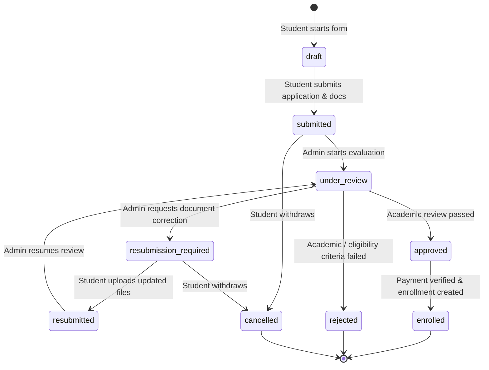

# PathFinder Course Application Management System — Approved Architecture Specification

**Document Version:** 1.4.0  
**Status:** Approved Requirements Specification (Post-Review Consistency, Privilege Hardening & Concurrency Refinement)  
**Approval Date:** 14 November 2026 (Updated: 15 November 2026)  
**Project Repository:** `F:/Project/pathfinder-forge-52`  
**Implementation Branch:** `feature/course-application-management`  
**Base Commit:** `0a9d79a95f28942e115bacf10d5166c6441e9267` (`origin/main`, fast-forward containing `1d9cb55dab3a7901f7575dd087b3599fc07c075d`)  
**Production Authorization Notice:** Production database migrations, Supabase schema modifications, and deployment changes have **NOT** yet been executed or authorized. This document records approved architectural decisions and specifications for development within this isolated worktree.

---

## 1. Approved Business Decisions (14 November 2026)

The following five architectural and business decisions were formally approved by project leadership on 14 November 2026 and govern all implementation work in this repository:

| Decision ID | Domain | Approved Policy & Specification | Status |
| :--- | :--- | :--- | :--- |
| **DEC-01** | **Course IDs & Relational Architecture** | **Keep `public.courses.id` as `TEXT`.** Do not migrate the column to `UUID`. Avoid destructive schema alterations on existing course rows. In new tables (`course_applications`), store `course_id` as `UUID` and validate references against `public.courses(id::text)` using database constraints/triggers. | **APPROVED** |
| **DEC-02** | **Student Identity & Guest Submissions** | **Allow guest (unauthenticated) applications.** Prospective students may submit applications prior to creating a user account. Applications can later be claimed after account creation using cryptographic verification of email ownership via `auth.users.email_confirmed_at` and single-use claim token hashes with expiration. | **APPROVED** |
| **DEC-03** | **Review & Payment Sequencing** | **Academic evaluation occurs first; payment verification is required before enrollment activation.** Applications are vetted academically (`submitted` $\to$ `under_review` $\to$ `approved`). Actual enrollment in `public.enrollments_users` occurs only when payment verification is satisfied (`verified`, `waived`, or `not_required`). | **APPROVED** |
| **DEC-04** | **Document Upload Limits** | **Maximum file size is 10 MB per file.** Accepted formats are strictly `application/pdf`, `image/jpeg`, and `image/png`. Enforce binary magic-byte inspection before storage commit. | **APPROVED** |
| **DEC-05** | **Data Retention & Privacy** | **Approved applications:** Retain for 5 years for academic accreditation and verification.<br/>**Rejected applications:** Retain for 1 year for reapplication context and fraud prevention.<br/>**Personal Identity Documents:** Retain for 180 days post-decision for privacy compliance.<br/>**Audit Logs:** Retain permanently for regulatory compliance. | **APPROVED** |

---

## 2. System Domain Separation

The Course Application Management System cleanly separates candidate evaluation from operational course access:

```mermaid
flowchart LR
    subgraph AppDomain["1. Application Domain (Evaluation)"]
        CA["public.course_applications"]
        CAD["public.course_application_documents"]
        CAL["public.course_application_audit_logs"]
    end

    subgraph EnrollDomain["2. Enrollment Domain (Access)"]
        EU["public.enrollments_users<br/>(Active Operational Table)"]
        LE["public.enrollments<br/>(Legacy Table - Preserved)"]
    end

    CA -->|Academic Approval + Payment Verified| RPC[approve_course_application_and_enroll]
    RPC -->|Atomic Materialization (Advisory Locked)| EU
```

1. **Application Domain (`course_applications`):** Governs candidate vetting, academic background, document verification, resubmission workflows, and payment auditing.
2. **Enrollment Domain (`enrollments_users`):** Governs student dashboard access, course material unlocking, and counselor WhatsApp routing. Entries are created in `enrollments_users` **only** upon final enrollment activation.

---

## 3. Application Lifecycle State Machine



### State Definitions
- **`draft`:** Student initialized an application but has not finalized submission.
- **`submitted`:** Application finalized and queued for administrator review.
- **`under_review`:** Administrator assigned and actively reviewing academic criteria.
- **`resubmission_required`:** Administrator identified an invalid/illegible document; student notified.
- **`resubmitted`:** Student uploaded replacement documents; re-entered review queue.
- **`approved`:** Academic criteria met. Awaiting payment verification (if fee-based).
- **`enrolled`:** Terminal positive state. Atomic enrollment created in `public.enrollments_users`.
- **`rejected`:** Terminal negative state. Academic criteria or capacity limits not met.
- **`cancelled`:** Student voluntarily withdrew prior to enrollment.

---

## 4. Payment Workflow Specifications

Payment rules differ by course and applicant:
1. **Fee-Free Courses:** Application automatically assigned `payment_status = 'not_required'`.
2. **Scholarships / Waivers:** Administrator assigns `payment_status = 'waived'` with audit notes.
3. **Fee-Based Courses:** Application assigned `payment_status = 'unpaid'`. Upon student payment proof submission, status advances to `'pending_verification'`.
4. **Verification:** Administrator cross-references payment reference (UTR / transaction ID) and moves status to `'verified'`.
5. **Precondition for Enrollment:** Both the atomic approval RPC and the table-level check constraint enforce:
   `status != 'enrolled' OR payment_status IN ('verified', 'waived', 'not_required')`.

---

## 5. Database Schema Specifications

### 5.1 `public.course_applications`
```sql
CREATE SEQUENCE IF NOT EXISTS public.course_application_number_seq START 1;

CREATE TABLE public.course_applications (
    id UUID PRIMARY KEY DEFAULT gen_random_uuid(),
    application_number TEXT UNIQUE NOT NULL DEFAULT public.generate_course_application_number(),
    user_id UUID REFERENCES auth.users(id) ON DELETE SET NULL, -- Nullable for guest submissions (DEC-02)
    guest_claim_token_hash TEXT NULL, -- Cryptographic hash of single-use claiming token
    guest_claim_token_expires_at TIMESTAMPTZ NULL, -- Expiration timestamp for guest claim token (7-day default TTL)
    course_id UUID NOT NULL, -- Validated via trigger against public.courses(id::text) (DEC-01)
    student_name TEXT NOT NULL,
    student_email TEXT NOT NULL,
    student_phone TEXT,
    academic_background JSONB NOT NULL DEFAULT '{}'::jsonb,
    statement_of_purpose TEXT,
    status TEXT NOT NULL DEFAULT 'submitted' CHECK (
        status IN (
            'draft',
            'submitted',
            'under_review',
            'resubmission_required',
            'resubmitted',
            'approved',
            'enrolled',
            'rejected',
            'cancelled',
            'revoked',
            'suspended'
        )
    ),
    payment_status TEXT NOT NULL DEFAULT 'unpaid' CHECK (
        payment_status IN ('not_required', 'unpaid', 'pending_verification', 'verified', 'waived', 'refunded', 'disputed')
    ),
    payment_reference TEXT,
    payment_amount_inr NUMERIC(10, 2),
    assigned_admin_id UUID REFERENCES auth.users(id) ON DELETE SET NULL,
    enrollment_id UUID REFERENCES public.enrollments_users(id) ON DELETE SET NULL,
    rejection_reason TEXT,
    resubmission_notes TEXT,
    submitted_at TIMESTAMPTZ DEFAULT now(),
    approved_at TIMESTAMPTZ,
    rejected_at TIMESTAMPTZ,
    created_at TIMESTAMPTZ DEFAULT now() NOT NULL,
    updated_at TIMESTAMPTZ DEFAULT now() NOT NULL,

    -- Defense-in-depth: Enforce lifecycle separation (DEC-03)
    CONSTRAINT chk_course_applications_enrolled_payment CHECK (
        status != 'enrolled' OR payment_status IN ('verified', 'waived', 'not_required')
    )
);

CREATE INDEX idx_course_applications_email ON public.course_applications (lower(trim(student_email)));
CREATE INDEX idx_course_applications_user_id ON public.course_applications (user_id);
CREATE INDEX idx_course_applications_guest_claim ON public.course_applications (guest_claim_token_hash, guest_claim_token_expires_at) WHERE guest_claim_token_hash IS NOT NULL;
CREATE INDEX idx_course_applications_course_id ON public.course_applications (course_id);
CREATE INDEX idx_course_applications_status ON public.course_applications (status);
```

### 5.2 Application-Number Generation Specification
The agreed application-number format across schema and architecture is:
```text
APP-YYYY-00001
```
- **Generator Function:** `public.generate_course_application_number()`
- **Sequence:** `public.course_application_number_seq` starting at 1.
- **Components:**
  1. Static prefix `APP-`
  2. Four-digit UTC year string `TO_CHAR(timezone('utc'::text, now()), 'YYYY')`
  3. Hyphen `-`
  4. Sequence number zero-padded to 5 digits via `LPAD(NEXTVAL(...)::TEXT, 5, '0')`
- **Distinction on Timezone Handling:** Converting `now()` to UTC timestamp for string extraction in `TO_CHAR` is deliberate for year extraction, whereas column timestamps default natively to `now()` (`TIMESTAMPTZ`).

### 5.3 Course Referential Integrity & Deletion Protection (DEC-01)
To protect references without altering the `public.courses.id` type from TEXT:
1. **Application-side Validation Trigger (`trg_validate_course_application_course_id`):**
   - Validates that `NEW.course_id::text` exists in `public.courses`.
   - Acquires `FOR KEY SHARE` row lock to eliminate race conditions against concurrent course updates.
   - Configured with `SECURITY DEFINER` and `SET search_path = pg_catalog, public, pg_temp` to allow guest submissions even if caller lacks direct SELECT rights on courses under RLS.
   - Execution revoked from `PUBLIC` (`REVOKE EXECUTE ON FUNCTION public.validate_course_application_course_id() FROM PUBLIC;`).
2. **Course-side Protection Trigger (`trg_prevent_course_deletion_or_id_change`):**
   - Fires `BEFORE UPDATE OF id OR DELETE ON public.courses`.
   - Forbids deletion or ID modification if any record in `public.course_applications` references the course.
   - Enforces the business rule that courses should be retired or archived rather than deleted once applications exist.
   - Execution revoked from `PUBLIC` (`REVOKE EXECUTE ON FUNCTION public.prevent_referenced_course_deletion_or_id_change() FROM PUBLIC;`).

### 5.4 `public.course_application_documents`
```sql
CREATE TABLE public.course_application_documents (
    id UUID PRIMARY KEY DEFAULT gen_random_uuid(),
    application_id UUID NOT NULL REFERENCES public.course_applications(id) ON DELETE CASCADE,
    document_type TEXT NOT NULL CHECK (
        document_type IN ('resume', 'academic_transcript', 'id_proof', 'payment_proof', 'other')
    ),
    file_name TEXT NOT NULL,
    file_size_bytes BIGINT NOT NULL CHECK (file_size_bytes > 0 AND file_size_bytes <= 10485760),
    mime_type TEXT NOT NULL CHECK (mime_type IN ('application/pdf', 'image/jpeg', 'image/png')),
    storage_path TEXT UNIQUE NOT NULL,
    sha256_hash TEXT,
    is_archived BOOLEAN NOT NULL DEFAULT false,
    archived_at TIMESTAMPTZ,
    created_at TIMESTAMPTZ DEFAULT now() NOT NULL
);

CREATE INDEX idx_app_documents_app_id ON public.course_application_documents (application_id);
```

### 5.5 `public.course_application_audit_logs` (Immutability Architecture)
```sql
CREATE TABLE public.course_application_audit_logs (
    id BIGSERIAL PRIMARY KEY,
    application_id UUID REFERENCES public.course_applications(id) ON DELETE SET NULL,
    actor_id UUID REFERENCES auth.users(id) ON DELETE SET NULL,
    actor_role TEXT NOT NULL CHECK (actor_role IN ('admin', 'student', 'system', 'service_role')),
    action TEXT NOT NULL,
    previous_state JSONB,
    new_state JSONB,
    notes TEXT,
    ip_address INET,
    user_agent TEXT,
    created_at TIMESTAMPTZ DEFAULT now() NOT NULL
);

-- Immutability enforcement
REVOKE UPDATE, DELETE, TRUNCATE ON public.course_application_audit_logs FROM PUBLIC, anon, authenticated;
```
- **Immutability Triggers:** Row-level triggers reject `UPDATE` and `DELETE`, and a statement-level trigger rejects `TRUNCATE`.
- **Operational Boundary:** Protects against application and client roles. Does not prevent PostgreSQL superusers (`postgres` / `supabase_admin`) from modifying tables or disabling triggers.

### 5.6 `public.notification_outbox`
```sql
CREATE TABLE public.notification_outbox (
    id BIGSERIAL PRIMARY KEY,
    application_id UUID REFERENCES public.course_applications(id) ON DELETE SET NULL,
    recipient_email TEXT NOT NULL,
    template_name TEXT NOT NULL CHECK (
        template_name IN (
            'application_received',
            'review_started',
            'resubmission_required',
            'application_approved',
            'application_rejected',
            'enrollment_confirmed',
            'enrollment_revoked'
        )
    ),
    payload JSONB NOT NULL DEFAULT '{}'::jsonb,
    idempotency_key TEXT UNIQUE NOT NULL,
    status TEXT NOT NULL DEFAULT 'pending' CHECK (status IN ('pending', 'processing', 'sent', 'failed', 'dead_letter')),
    attempts INTEGER NOT NULL DEFAULT 0,
    max_attempts INTEGER NOT NULL DEFAULT 5,
    locked_until TIMESTAMPTZ,
    last_error TEXT,
    next_attempt_at TIMESTAMPTZ DEFAULT now() NOT NULL,
    sent_at TIMESTAMPTZ,
    created_at TIMESTAMPTZ DEFAULT now() NOT NULL
);

CREATE INDEX idx_notification_outbox_queue ON public.notification_outbox (next_attempt_at, locked_until)
WHERE status IN ('pending', 'failed');
```

---

## 6. Concurrency, Advisory Locks & Idempotent Approval

### Crucial Relational Facts
1. Production table `public.enrollments_users` has **NO unique constraint** on `(student_email, course_id)`. Therefore, PostgreSQL `INSERT ... ON CONFLICT (student_email, course_id)` is **invalid** and aborts at runtime.
2. Production table `public.enrollments_users` does **not** have an enrollment status column.
3. Arbitrary selection of existing enrollment records via `LIMIT 1` or aggregate functions (e.g. `MIN(id)`) on UUID columns is strictly unsafe and invalid architectural design.
4. Two separate SQL queries (e.g., `SELECT count(*)` followed by `SELECT id`) can observe different snapshots under default `READ COMMITTED` isolation if concurrent writers commit between them.

### Approved Concurrency & Snapshot-Consistent Deduplication Architecture
To guarantee race-free, idempotent enrollment creation without modifying existing tables or suffering from snapshot skew:
1. **Application Dossier Row Lock:**
   `SELECT * FROM public.course_applications WHERE id = p_application_id FOR UPDATE;`
2. **Dual-Key Transaction Advisory Lock:**
   Acquire an advisory lock scoped to the transaction using two independent 32-bit hash namespaces (normalized email and course_id):
   ```sql
   PERFORM pg_advisory_xact_lock(
       hashtext(lower(trim(v_app.student_email))),
       hashtext(v_app.course_id::text)
   );
   ```
3. **Single Snapshot-Consistent Deduplication & Safe Collision Handling (Inside Lock):**
   ```sql
   -- 1. Single snapshot query: obtain match count and candidate UUID from identical statement snapshot
   SELECT count(*), (array_agg(id))[1]
   INTO v_match_count, v_candidate_id
   FROM public.enrollments_users
   WHERE lower(trim(student_email)) = lower(trim(v_app.student_email))
     AND course_id = v_app.course_id;

   IF v_match_count = 1 THEN
       -- 2. Exactly one record exists in this snapshot: reuse its UUID safely
       v_enrollment_id := v_candidate_id;

   ELSIF v_match_count > 1 THEN
       -- 3. Multiple conflicting records detected in this snapshot: fail safely and require reconciliation
       RAISE EXCEPTION 'Multiple conflicting enrollment records (%) found for student % and course %. Manual administrative reconciliation required.',
           v_match_count, v_app.student_email, v_app.course_id
           USING ERRCODE = 'data_exception';

   ELSE
       -- 4. Exactly zero existing enrollments: insert new record safely under transaction advisory lock
       INSERT INTO public.enrollments_users (
           student_name,
           student_email,
           course_id,
           enrollment_date
       ) VALUES (
           v_app.student_name,
           lower(trim(v_app.student_email)),
           v_app.course_id,
           now()
       )
       RETURNING id INTO v_enrollment_id;
   END IF;
   ```
4. **Link Application:** Set `course_applications.enrollment_id = v_enrollment_id` and `status = 'enrolled'`.
5. **Idempotent Return:** If the RPC is called again for an already-enrolled application, it immediately returns the existing enrollment ID without modifying anything.
6. **Future Audit Requirement:** Prior to introducing any database-level unique constraint on `(student_email, course_id)`, an authorized read-only deduplication audit must be conducted on production `enrollments_users`.

### Explicit Concurrency Limitation & Boundary
> [!IMPORTANT]
> **Advisory Lock Boundary Limitation:**
> The transaction-scoped advisory lock (`pg_advisory_xact_lock`) coordinates **only** cooperative writers that execute within this approved application approval workflow using the identical `(hashtext(email), hashtext(course_id))` key protocol.
> It does **not** block or serialize uncoordinated legacy processes, manual administrative database inserts, or external integrations that write directly to `public.enrollments_users` without acquiring this advisory lock.
> Therefore, this mechanism does **not** provide an absolute database-level mathematical uniqueness guarantee. True relational uniqueness requires an explicit database unique constraint or unique index on `(lower(trim(student_email)), course_id)`. Such a constraint cannot be safely introduced until an authorized read-only deduplication audit of existing production `enrollments_users` data is conducted in Phase 3.4.

---

## 7. Student Identity & Guest Claiming Security (DEC-02)

### Complete Mandatory Claim Authorization Conditions
A guest application claim operation must strictly enforce **ALL** eleven of the following criteria in a single atomic transaction:
1. **Unassigned Target:** `user_id IS NULL` on `course_applications`.
2. **Token Hash Present:** `guest_claim_token_hash IS NOT NULL`.
3. **Cryptographic Hash Match:** The SHA-256 hash of the supplied plaintext token matches `guest_claim_token_hash` byte-for-byte.
4. **Token Expiration Present:** `guest_claim_token_expires_at IS NOT NULL`.
5. **Not Expired:** `guest_claim_token_expires_at > now()`.
6. **Authenticated Session:** Caller must be authenticated (`auth.uid() IS NOT NULL`).
7. **Verified Account Email:** Authenticated user account must be email-verified (`auth.users.email_confirmed_at IS NOT NULL`).
8. **Email Ownership Match:** Normalized authenticated account email matches normalized application email:
   `lower(trim(auth.users.email)) = lower(trim(course_applications.student_email))`.
9. **Atomic Execution:** Claiming must execute inside a database transaction with row-level locks.
10. **Token Invalidation on Consumption:** Successful claiming atomically sets **both** `guest_claim_token_hash = NULL` and `guest_claim_token_expires_at = NULL`.
11. **Anti-Hijacking Invariant:** An application with `user_id IS NOT NULL` can never be claimed or reassigned under any circumstances.

> [!CAUTION]
> **Security Invariant:** Never permit claiming merely because `guest_claim_token_hash IS NULL`. An unlinked application without a valid, unexpired claim token must request a new token via verified email dispatch.
> **Identity Verification Rule:** Never use a caller-supplied email parameter as proof of ownership. The email must be retrieved directly from `auth.users` using `auth.uid()`.

### Token Generation, Delivery & Security Rules
- **Entropy:** Server generates a cryptographically secure random token (CSPRNG, $\ge 32$ bytes of entropy, URL-safe base64/hex).
- **Default TTL:** **7 days (168 hours)** from generation timestamp across all system services.
- **Hash-Only Storage:** Only `sha256(token)` is persisted into `guest_claim_token_hash`. Plaintext tokens are never stored, logged, or exposed in API responses.
- **Single-Use:** Token cannot be reused after consumption.
- **Enumeration Defense:** The claim endpoint must return a generic response upon token failure or mismatched email, preventing bad actors from verifying whether an application exists for an arbitrary email.

### Illustrative Architectural Pattern for Future Claim RPC
*(Conceptual architecture example: Illustrates transactional security requirements; not executed against any database in this phase).*
```sql
CREATE OR REPLACE FUNCTION public.claim_guest_course_application(
    p_application_id UUID,
    p_plain_token TEXT
)
RETURNS BOOLEAN
LANGUAGE plpgsql
SECURITY DEFINER
SET search_path = pg_catalog, public, pg_temp
AS $$
DECLARE
    v_caller_id UUID;
    v_auth_email TEXT;
    v_email_confirmed_at TIMESTAMPTZ;
    v_supplied_token_hash TEXT;
    v_claimed_app_id UUID;
BEGIN
    -- 1. Obtain authenticated caller identity directly from context
    v_caller_id := auth.uid();
    IF v_caller_id IS NULL THEN
        RAISE EXCEPTION 'Authentication required.' USING ERRCODE = 'insufficient_privilege';
    END IF;

    -- 2. Authoritatively retrieve verified email directly from auth.users (never trust caller input)
    SELECT email, email_confirmed_at
    INTO v_auth_email, v_email_confirmed_at
    FROM auth.users
    WHERE id = v_caller_id;

    IF v_auth_email IS NULL OR v_email_confirmed_at IS NULL THEN
        -- Account exists but email is unconfirmed or null
        RAISE EXCEPTION 'Email confirmation required before claiming applications.'
            USING ERRCODE = 'insufficient_privilege';
    END IF;

    -- 3. Derive cryptographic SHA-256 hash from caller-supplied plaintext token
    -- Note on extension schema: digest() is provided by the pgcrypto extension.
    -- In Supabase, pgcrypto is typically installed in schema 'extensions' or 'public'.
    -- The exact schema has not been verified against production and must be confirmed prior to implementation.
    v_supplied_token_hash := encode(digest(p_plain_token, 'sha256'), 'hex');

    -- 4. Atomically lock and claim the application dossier
    -- Enforces all 11 security conditions:
    -- - Unlinked (user_id IS NULL)
    -- - Active token hash present (guest_claim_token_hash IS NOT NULL)
    -- - Exact cryptographic hash match
    -- - Expiry timestamp present and valid (guest_claim_token_expires_at > now())
    -- - Verified email ownership match (normalized)
    -- - Locks target row FOR UPDATE
    UPDATE public.course_applications
    SET user_id = v_caller_id,
        guest_claim_token_hash = NULL,
        guest_claim_token_expires_at = NULL,
        updated_at = now()
    WHERE id = p_application_id
      AND user_id IS NULL
      AND guest_claim_token_hash IS NOT NULL
      AND guest_claim_token_hash = v_supplied_token_hash
      AND guest_claim_token_expires_at IS NOT NULL
      AND guest_claim_token_expires_at > now()
      AND lower(trim(student_email)) = lower(trim(v_auth_email))
    RETURNING id INTO v_claimed_app_id;

    -- 5. Anti-Enumeration & Failure Handling:
    -- If no row matched or updated, return generic failure without revealing whether
    -- the application ID exists, belongs to another student, or had an expired token.
    IF v_claimed_app_id IS NULL THEN
        RAISE EXCEPTION 'Invalid claim request or expired token.'
            USING ERRCODE = 'invalid_parameter_value';
    END IF;

    -- 6. Record immutable compliance audit entry
    INSERT INTO public.course_application_audit_logs (
        application_id, actor_id, actor_role, action, notes
    ) VALUES (
        v_claimed_app_id,
        v_caller_id,
        'student',
        'APPLICATION_CLAIMED_BY_ACCOUNT',
        'Linked unauthenticated guest application to verified account via single-use claim token'
    );

    RETURN TRUE;
END;
$$;

-- Explicit Least-Privilege Execution Policy (Conceptual Draft):
REVOKE EXECUTE ON FUNCTION public.claim_guest_course_application(UUID, TEXT) FROM PUBLIC;
REVOKE EXECUTE ON FUNCTION public.claim_guest_course_application(UUID, TEXT) FROM anon;
GRANT EXECUTE ON FUNCTION public.claim_guest_course_application(UUID, TEXT) TO authenticated;
```

### Least-Privilege Execution & Security Boundary Documentation
1. **Explicit Role Grants:**
   - Default execution is revoked from `PUBLIC` and `anon`.
   - Execution is granted strictly to the `authenticated` role, ensuring only authenticated users with valid JWTs can invoke the endpoint.
2. **`SECURITY DEFINER` Rationale & Ownership:**
   - Elevated execution is strictly required so that the function can read `auth.users` to verify the caller's confirmed email, bypassing the restriction where client roles cannot read administrative auth tables under RLS.
   - It also performs atomic state transitions across `public.course_applications` and `public.course_application_audit_logs`.
   - **Trusted Owner Assumption:** Requires execution under a trusted database role (such as `postgres` or `supabase_admin`) possessing appropriate table privileges. The live production owner and ACLs have **not** been verified in this read-only phase.
3. **`digest()` Extension-Schema Unresolved Assumption:**
   - The illustrative claim function calls `digest()`, which is provided by PostgreSQL's `pgcrypto` extension.
   - A search of repository SQL files confirmed that no extension installation scripts exist in this codebase.
   - In standard Supabase environments, `pgcrypto` is installed in schema `extensions` (or occasionally `public`).
   - The exact schema of `pgcrypto` is **unverified**. When implementing the RPC in Phase 3.4/3.5, administrators must verify the extension's schema (e.g., `extensions.digest(...)` vs `public.digest(...)`, or ensuring `extensions` is present in the function's `search_path`).

---

## 8. Document Storage & Upload Security (DEC-04 & DEC-05)

- **Bucket ID:** `course-application-documents` (private, public read disabled).
- **Upload Flow:** Client requests temporary upload ticket $\to$ server generates signed upload URL (15-min expiry) $\to$ client uploads binary $\to$ server confirms SHA-256 hash and magic bytes.
- **Magic Bytes Validation:**
  - PDF: `%PDF-` (`0x25 0x50 0x44 0x46`)
  - PNG: `\x89PNG\r\n\x1a\n` (`0x89 0x50 0x4E 0x47 0x0D 0x0A 0x1A 0x0A`)
  - JPEG: `0xFF 0xD8 0xFF`
- **Retention Purging (DEC-05):**
  - Identity proofs (`id_proof`) purged after 180 days.
  - Document metadata deletion cascades, but storage bucket binaries must be purged via Storage API / webhook to avoid orphaned storage assets.

---

## 9. Notification Worker Architecture

- **Service Location:** Background process or scheduled worker in TanStack Start (`src/server.ts`).
- **Transport:** Existing Gmail SMTP connection pool (`src/lib/server/mail.ts`).
- **Job Lease Locking:** `SELECT ... FOR UPDATE SKIP LOCKED` with `locked_until = now() + interval '5 minutes'`.
- **Exponential Backoff:** Retries scheduled at $2^{\text{attempts}} \times 60$ seconds. Maximum 5 attempts before marking as `'dead_letter'`.

---

## 10. Bioinformatics Course Discrepancy & Frontend Alignment

### Discrepancy Classification
- An earlier manual inspection of production observed a course row:
  - **Title:** `Bioinformatics & Computational Biology`
  - **ID:** `619be200-832d-41e8-97b8-d0515031ae76`
- Conversely, repository setup documentation (`docs/BACKEND_SUPABASE_SETUP.md`) and frontend code (`src/lib/courses/store.ts`, `dashboard-courses.ts`) contain fallback shims referencing synthetic ID `"bioinformatics-frontend-seed"`.
- **Policy for Current Phase:**
  - The Phase 3.3.x activities have **not** connected to production Supabase.
  - Therefore, `619be200-832d-41e8-97b8-d0515031ae76` is treated as a *previously observed production identifier*, not an authorized database fact.
  - **No seed migration** will be drafted for Bioinformatics.
  - When live database access is authorized in a later phase, an administrator will verify whether `619be200-832d-41e8-97b8-d0515031ae76` exists. Once confirmed, frontend fallback seeds will be updated to point to that UUID.

---

## 11. Required Frontend Corrections (Phase 3 Implementation)

1. **[`src/routes/admin/dashboard.tsx:81`](file:///F:/Project/pathfinder-forge-52/src/routes/admin/dashboard.tsx#L81):** Change `from("enrollments")` to query `from("enrollments_users")`.
2. **[`src/routes/dashboard/index.tsx:66`](file:///F:/Project/pathfinder-forge-52/src/routes/dashboard/index.tsx#L66):** Change `.select("course_id, enrolled_at")` to `.select("course_id, enrollment_date")` and update line 87 to read `e.enrollment_date`.
3. **[`src/lib/courses/store.ts:349`](file:///F:/Project/pathfinder-forge-52/src/lib/courses/store.ts#L349):** Append `.select("id, slug").single()` to `syncCourseToSupabase` to capture database UUIDs and eliminate synthetic local storage IDs.
4. **[`src/lib/courses/dashboard-courses.ts:53`](file:///F:/Project/pathfinder-forge-52/src/lib/courses/dashboard-courses.ts#L53):** Update fallback ID once production database course row verification is performed.
