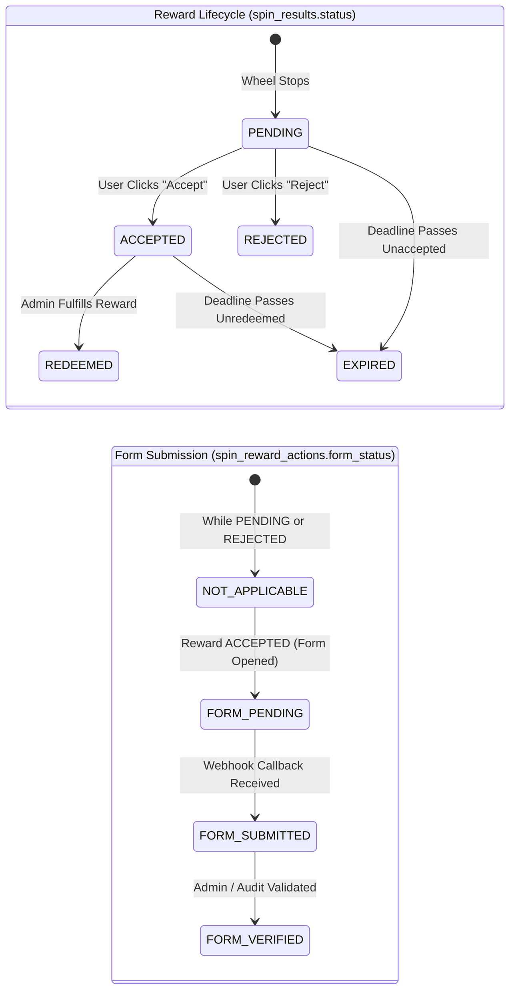

# PATHFINDER SPIN & WIN — OFFICIAL SPECIFICATION & PROJECT RULES
**Repository**: `pathfinder-forge-52`  
**Branch**: `bri-ui-redesign`  
**Target Domain**: Micrylis Biotech / PathFinder  
**Document Status**: Permanent Project Specification & Architecture Blueprint  
**Authentication Architecture**: Supabase Auth Email OTP + External Production SMTP  
**Last Updated**: November 2026 (Updated: Technical Corrections Applied)  

---

## 1. Executive Summary & Objective

The **PathFinder Spin & Win** campaign is an interactive marketing and gamification feature designed to engage visitors, introduce them to Micrylis Biotech mentorship and research programs, and capture verified email leads with guaranteed fair reward distribution.

This document establishes the authoritative rules, security protocols, database schemas, cryptographic mechanisms, and operational workflows for the feature. All implementation steps must strictly adhere to the contracts defined herein.

**Key Architecture Update**: All dependencies on phone numbers, SMS gateways, MSG91, and TRAI DLT registrations have been removed. Authentication and identity verification are now powered strictly by **Supabase Auth Email OTP** backed by an **external production SMTP provider**.

---

## 2. Core Feature Rules & System Requirements

### Rule 1: One Verified Email Address = Exactly One Spin
* **Mandatory Business Rule**: A single verified, normalized email address receives **exactly one spin** for the entire duration of the campaign.
* **Consistent Normalization Strategy**:
  * All email addresses must be strictly normalized across client, server, and database layers:
    $$\text{normalized\_email} = \text{lower}(\text{trim}(\text{email}))$$
  * Trim leading and trailing whitespace.
  * Convert all characters to lowercase.
  * Validate against standard RFC 5322 regex: `/^[^\s@]+@[^\s@]+\.[^\s@]+$/`.
* **Database-Level Uniqueness Enforcement**:
  * Enforced on `public.spin_participants` via an explicit unique constraint on the normalized column:
    ```sql
    CONSTRAINT check_spin_participants_email_normalized CHECK (email = lower(trim(email))),
    CONSTRAINT spin_participants_email_unique UNIQUE (email)
    ```
  * Enforced via a functional unique index:
    ```sql
    CREATE UNIQUE INDEX idx_spin_participants_email_normalized ON public.spin_participants (lower(trim(email)));
    ```
  * Strict 1:1 participant-to-result mapping: `spin_results.participant_id UUID NOT NULL UNIQUE REFERENCES public.spin_participants(id)`.
* **Atomic Idempotency & Lost Response Recovery**:
  * Concurrency protection guarantees that simultaneous requests using the same email address cannot generate duplicate spins.
  * If a spin transaction succeeds but the network response is lost, any subsequent retry returns the existing persisted result rather than rolling again or failing.
* **Storage Independence**: The system never relies on `localStorage`, `sessionStorage`, browser cookies, IP addresses, or client-side flags as the enforcement mechanism. Refreshing, clearing storage, switching browsers, or using incognito mode will never grant an additional spin.
* **Irrevocable Participation**: Once a spin is recorded, rejecting or failing to redeem a reward does not restore spin eligibility.

---

### Rule 2: Supabase Auth Email OTP & External SMTP Delivery Architecture

#### A. Verified-User Lifecycle & Supabase Auth Execution Details
The application utilizes Supabase Auth’s native Email OTP mechanism. The precise lifecycle behavior is as follows:

1. **User Registration Form**:
   * Visitor enters their **Full Name** and **Email Address**.
   * Client normalizes the email address (`email.trim().toLowerCase()`).
2. **Pre-Check Deduplication**:
   * The database is queried via a lightweight server check *before* calling Supabase Auth.
   * If the normalized email already exists in `spin_participants`, the user is immediately transitioned to the **"Already Participated" / Active Reward Status** view, incurring zero SMTP cost.
3. **`signInWithOtp` Call & User Lifecycle**:
   * The client or server calls:
     ```typescript
     const { data, error } = await supabase.auth.signInWithOtp({
       email: normalizedEmail,
       options: {
         data: { full_name: name.trim() },
         shouldCreateUser: true,
       },
     });
     ```
   * **Supabase User Lifecycle Behavior**:
     * When `shouldCreateUser: true` is passed (default), Supabase Auth immediately checks `auth.users`.
     * If the email does **not** exist in `auth.users`, Supabase Auth inserts an unconfirmed user record with `confirmed_at = NULL` and `email_confirmed_at = NULL`, saving `raw_user_meta_data`.
     * *(Note: If `public.handle_new_user()` trigger is active, it syncs this record to `public.profile` / `public.users`)*.
     * If the user already exists in `auth.users`, Supabase does not create a duplicate; it simply generates a new OTP token for that user.
     * Supabase Auth generates a secure 6-digit OTP code (valid for 10 minutes) and dispatches it via the configured custom SMTP provider.
4. **`verifyOtp` Call**:
   * Participant enters the 6-digit code into `InputOTP`.
   * The code is verified via Supabase Auth:
     ```typescript
     const { data, error } = await supabase.auth.verifyOtp({
       email: normalizedEmail,
       token: enteredOtp,
       type: "email",
     });
     ```
   * **Post-Verification State**:
     * Upon valid OTP matching, Supabase Auth updates `auth.users`, setting `email_confirmed_at = now()`.
     * Supabase returns a cryptographically signed user session containing `access_token` (JWT), `refresh_token`, and the verified `user` object (`user.id`, `user.email`).
5. **Zero-Trust Server Identity Binding**:
   * The browser **never** passes `email` or `user_id` as trusted parameters to spin or reward endpoints.
   * Instead, the client sends the Supabase Auth JWT in the `Authorization: Bearer <access_token>` header.
   * The server function validates the token using:
     ```typescript
     const { data: { user }, error } = await supabaseAdmin.auth.getUser(token);
     if (error || !user || !user.email) {
       throw new Error("Unauthorized: Invalid or expired authentication session.");
     }
     const verifiedEmail = user.email.trim().toLowerCase();
     const verifiedUserId = user.id;
     ```
   * The participant identity is derived **solely** from this verified server-side user context. An attacker cannot impersonate another participant by spoofing payload parameters.

#### B. External SMTP Provider Requirement
* **Supabase Default Rate Limit Warning**: Supabase’s built-in default email service is restricted to a hard limit of **3 to 4 emails per hour** for the entire project. It is strictly meant for local development and **cannot** be used for public production traffic.
* **Mandatory Custom SMTP**: An external SMTP provider **MUST** be connected in Supabase Project Settings:
  * Location: *Supabase Dashboard $\rightarrow$ Project Settings $\rightarrow$ Authentication $\rightarrow$ SMTP Settings*.
  * Settings required: Host, Port, Username, Password, Sender Email, Sender Name.

#### C. Free-Tier SMTP Provider Analysis & Realities
| Provider | Free Tier Allowance | Sending Method | Deliverability & Reputation | Notes / Suitability |
|---|---|---|---|---|
| **Resend** | **100 emails/day** (3,000/mo) | SMTP / REST API | Exceptionally high (AWS SES backbone) | Requires custom domain verification (DKIM/SPF). Clean developer experience. |
| **Brevo** (Sendinblue) | **300 emails/day** | SMTP / REST API | High | Generous daily volume on free tier. Requires domain DNS verification. |
| **SendGrid** | **100 emails/day** | SMTP / REST API | High | Strict compliance review for new accounts. |
| **Gmail SMTP** (App Password) | **500 emails/day** (Personal) / 2,000/day (Workspace) | SMTP (`smtp.gmail.com:465/587`) | High (Direct Google IP) | Already utilized in PathFinder (`src/lib/server/mail.ts`). Requires Google Account 2FA App Password. |

> [!IMPORTANT]
> **Free-Tier Capacity Rule**: While free-tier providers (Brevo, Resend, or Gmail SMTP) can cover initial staging and moderate traffic, free tiers cannot be assumed sufficient for viral or high-volume public campaigns. If campaign traffic exceeds 300 spins/day, a paid tier or dedicated transactional plan must be activated.

#### D. Rate Limiting, Cooldowns & Expiry
* **Resend Cooldown**: Minimum 60 seconds between OTP requests for the same email address.
* **Hourly Cap**: Maximum 3 OTP requests per email address per hour.
* **Failed Attempt Lockout**: Maximum 5 incorrect OTP attempts before the code is invalidated.
* **OTP Expiration**: OTP codes expire after 10 minutes.
* **Single-Use Spin Token**: Once verified, the spin must be executed within 15 minutes, after which the session expires.

---

### Rule 3: Approved Reward Categories & Exact Probabilities
The reward distribution is mathematically locked to the following discrete probabilities:

| Segment | Reward Key | Reward Title & Description | Exact Probability | Integer Interval Range ($X \in [1, 100]$) | Wheel Angle Center |
|:---:|---|---|:---:|:---:|:---:|
| **0** | `DISCOUNT_25` | **25% Discount** on any program | **25%** | $1 \le X \le 25$ | $30^\circ$ |
| **1** | `DISCOUNT_50` | **50% Discount** on any program | **20%** | $26 \le X \le 45$ | $90^\circ$ |
| **2** | `FREE_MENTORSHIP` | **FREE Mentorship Session** | **20%** | $46 \le X \le 65$ | $150^\circ$ |
| **3** | `FOUNDER_CALL` | **Live Call with the Founder** | **20%** | $66 \le X \le 85$ | $210^\circ$ |
| **4** | `IELTS_INTERVIEW` | **Free IELTS Interview Session** | **14%** | $86 \le X \le 99$ | $270^\circ$ |
| **5** | `FREE_FULL_PROJECT` | **Free Full Project (Any)** | **1%** | $X = 100$ | $330^\circ$ |
| **TOTAL** | | | **100%** | **100 Integer Values** | **$360^\circ$** |

---

### Rule 4: Cryptographically Secure Server-Side Reward Selection
* **Zero Client Authority**: The browser **never** selects, influences, or overrides the winning reward. Any incoming client parameter proposing a reward is rejected.
* **CSPRNG Source**: The server selects the winning reward using Node.js `crypto.randomInt(1, 101)`, which generates a cryptographically secure, uniform pseudo-random integer between 1 and 100 inclusive.
* **Deterministic Angle Synchronization**: Once the server selects the winning reward, it looks up the segment geometry and calculates the target stopping angle. The server returns `{ rewardKey, rewardTitle, segmentIndex, targetAngle }` to the client.
* **Frontend Animation**: The client animates the wheel rotation:
  $$\text{Total Rotation} = (360^\circ \times 5) + (360^\circ - \text{targetAngle}) \pm \text{jitter}$$
  *(Jitter is restricted to $\pm 10^\circ$ to maintain aesthetic realism while guaranteeing the pointer remains firmly within the selected slice).*

---

### Rule 5: Atomic Database Enforcement & Idempotency
* **Single Atomic Transaction**: Spin token consumption, participant creation, and reward assignment are executed within a single PostgreSQL transaction or `SECURITY DEFINER` stored procedure (`execute_spin_atomic`).
* **Concurrency Locking**: Row-level locking (`FOR UPDATE`) on the verification session and participant record prevents race conditions from concurrent duplicate submissions.
* **Idempotency & Replay Protection**:
  * If a spin transaction succeeds but the client experiences a network timeout or disconnect before receiving the response, subsequent retries by that participant return the **existing persisted result** with `is_existing: true`.
  * Concurrent duplicate requests fail cleanly without creating multiple participants or results.

---

### Rule 6: Participant Registration & Privacy
* **Registration Fields**:
  * Full Name (trimmed, sanitized, 2–100 characters).
  * Email Address (validated, lowercase, normalized).
* **Metadata Collected**:
  * Client IP Address (for rate limiting and fraud analysis).
  * User-Agent Header (for device auditing).
  * Timestamps (UTC stored in database, IST rendered in UI).
* **Data Minimization & Masking**:
  * Public routes never expose participant email addresses.
  * In the admin dashboard, email addresses are masked by default (`b***h@micrylis.com` or `j***e@domain.com`) with audit-logged unmasking available only to authorized administrators.

---

### Rule 7: Decoupled Reward Lifecycle & Form Submission State Machines

The application maintains two **completely decoupled, independent state machines** to avoid conflicting or invalid states:



#### A. Authoritative Reward Lifecycle Status (`spin_results.status`)
1. `PENDING`: Wheel animation completed; participant has not yet decided to accept or reject.
2. `ACCEPTED`: Participant clicked "Accept"; reward is formally reserved pending Google Form completion and admin fulfillment.
3. `REJECTED`: Participant clicked "Reject"; reward is permanently forfeited. User is redirected to homepage; eligibility is not restored.
4. `REDEEMED`: Admin has verified form submission and fulfilled the reward (e.g. issued coupon code, scheduled founder call or mentorship session).
5. `EXPIRED`: Deadline passed (20 November 2026, 23:59:59 IST) before acceptance or fulfillment.

#### B. Independent Form Submission Status (`spin_reward_actions.form_status`)
1. `NOT_APPLICABLE`: Default state while reward is `PENDING`, or if reward is `REJECTED`.
2. `FORM_PENDING`: Participant accepted reward and opened the Google Form in a new tab; submission is pending user completion.
3. `FORM_SUBMITTED`: Automated webhook received from Google Apps Script with valid HMAC signature, proving the Google Form was submitted.
4. `FORM_VERIFIED`: Administrator or automated verification verified the row in the linked Google Sheet against participant eligibility.

---

### Rule 8: Google Form Submission Tracking
* **Six Separate Google Forms**: Each reward category corresponds to a dedicated Google Form URL configured via server environment variables.
* **Pre-Filled Parameter Contract**: Form URLs include pre-filled query parameters:
  * Participant Name (`entry.NAME_ID`)
  * Normalized Email (`entry.EMAIL_ID`)
  * Result UUID (`entry.RESULT_ID`)
* **Tracking Distinction**:
  * *Form Opened*: The application detects when the user clicks "Accept" and opens the form URL. Status transitions to `FORM_PENDING`.
  * *Form Submitted*: Google Forms cannot automatically redirect back to the application.
* **Automated Webhook via Google Sheets & Apps Script**:
  1. Each Google Form is linked to a Google Sheet.
  2. A Google Apps Script `onFormSubmit(e)` trigger monitors new entries.
  3. The script sends an HTTPS POST request to PathFinder’s webhook endpoint (`/api/spin-webhook`).
  4. The webhook payload includes `{ result_id, email, submitted_at }` signed with a shared HMAC-SHA256 signature (`X-Spin-Signature`).
  5. The backend validates the signature, marks `form_status = 'FORM_SUBMITTED'`, and logs the event.
* **Manual Admin Fallback**: In the `/spin-admin` dashboard, administrators have a manual *"Verify Form Submission"* button to verify submissions offline or resolve discrepancies.

---

### Rule 9: Campaign Expiry & Timezone Enforcement
* **Campaign Deadline**: **20 November 2026, 23:59:59 IST** (`Asia/Kolkata` / UTC+05:30).
* **UTC Equivalent**: `2026-11-20T18:29:59.000Z`.
* **Server-Side Enforcement**: All eligibility checks, OTP dispatches, spin executions, and form redemptions enforce:
  ```sql
  now() <= '2026-11-20 23:59:59+05:30'::timestamptz
  ```
* **Client Device Clock Protection**: Client timestamps are never trusted. All expiration decisions are based strictly on database and server time.
* **Post-Deadline Behavior**: After the deadline passes, unredeemed or uncompleted rewards transition to `EXPIRED` status and can no longer be claimed.

---

### Rule 10: Dedicated `/spin-admin` Dashboard & Server-Side Security
* **Dedicated Route**: Located at `/spin-admin`, completely isolated from the standard student/mentor admin panel.
* **Strict Server-Side Authorization**:
  * The dashboard never relies on client-side route guards or `sessionStorage` tokens alone.
  * All administrative server functions (`getSpinAdminData`, `updateRewardStatus`, `exportSpinCsv`) verify credentials server-side via Supabase Auth admin session or a protected server admin secret.
* **Capabilities**:
  * Metric cards: Total participants, spins, acceptances, rejections, forms submitted, redeemed rewards, expired rewards.
  * Real-time search: Lookup by email address or name.
  * Filtering: Filter by reward category, acceptance status, and form status.
  * Masked Data Protection: Participant emails are masked by default (`b***h@micrylis.com`) with audited reveal controls.
  * CSV Export: Download complete participant and redemption audit data.
  * Audit Trail: Immutable logging of all administrative status changes.

---

### Rule 11: Dedicated `/spin` Route & Global Popup Behavior
* **Global Website Popup Behavior**:
  * **New Visit / Session**: The Spin & Win popup opens automatically when a visitor arrives on public pages of the website (after a polite 2.5-second delay to protect Core Web Vitals).
  * **Session Navigation Suppression**: Once the popup is displayed, dismissed (via 'X' or backdrop click), or interacted with, `sessionStorage.setItem('spin_popup_dismissed_session', 'true')` is set. Navigating between routes (`/courses`, `/events`, `/about`, etc.) within that session **will not** re-trigger the popup.
  * **Returning Participants**: The popup is **NEVER** permanently suppressed. When a returning participant revisits the website in a new session (or navigates to `/spin`):
    * The popup opens as expected.
    * If their Supabase session is active or upon entering their email, the system detects their previous participation.
    * Instead of a blank wheel, the popup renders their **Active Reward Status Card**, showing what they won, their current reward status (`ACCEPTED`, `REDEEMED`, `REJECTED`, `EXPIRED`), their form status (`FORM_PENDING`, `FORM_SUBMITTED`, `FORM_VERIFIED`), and providing direct links to complete their Google Form.
  * **Excluded Routes**: The popup is permanently disabled on `/admin/*`, `/spin-admin/*`, `/dashboard/*`, and login/auth callback routes.
* **Dedicated `/spin` Route**:
  * Standalone full-page route rendering the spin experience directly without modal wrapping.
  * Equipped with custom OpenGraph / Twitter metadata: *"Spin the Micrylis Biotech Wheel & Win Guaranteed Rewards"*.
  * Primary target for marketing campaigns, direct links, and QR codes.

---

### Rule 12: QR Code Asset Specifications
* **Target URL**: Points directly to the production `/spin` route (e.g. `https://pathfinder.micrylis.com/spin`).
* **Deliverables Required**:
  1. High-resolution PNG (300 DPI, minimum 2048×2048px).
  2. Vector SVG (infinitely scalable with embedded brand logo).
  3. Print-ready vector PDF formatted for banners, standees, and brochures.
* **Execution Timing**: Final QR code generation will occur only after the production domain and canonical routing are finalized.

---

### Rule 13: Supabase Row Level Security & Hardened Database Schema

#### A. Database Schema
```sql
-- 1. Participants Table (Enforces One Email = One Participant)
CREATE TABLE IF NOT EXISTS public.spin_participants (
    id UUID PRIMARY KEY DEFAULT gen_random_uuid(),
    supabase_user_id UUID REFERENCES auth.users(id) ON DELETE SET NULL,
    name TEXT NOT NULL,
    email TEXT NOT NULL,
    ip_address TEXT,
    user_agent TEXT,
    created_at TIMESTAMPTZ DEFAULT timezone('utc'::text, now()) NOT NULL,
    updated_at TIMESTAMPTZ DEFAULT timezone('utc'::text, now()) NOT NULL,
    CONSTRAINT check_spin_participants_email_normalized CHECK (email = lower(trim(email))),
    CONSTRAINT spin_participants_email_unique UNIQUE (email)
);
CREATE UNIQUE INDEX IF NOT EXISTS idx_spin_participants_email_normalized 
    ON public.spin_participants (lower(trim(email)));

-- 2. Verification Sessions Table (Temporary single-use spin authorizations)
CREATE TABLE IF NOT EXISTS public.spin_sessions (
    id UUID PRIMARY KEY DEFAULT gen_random_uuid(),
    email TEXT NOT NULL,
    spin_token_hash TEXT NOT NULL UNIQUE,
    otp_verified_at TIMESTAMPTZ DEFAULT timezone('utc'::text, now()) NOT NULL,
    expires_at TIMESTAMPTZ NOT NULL,
    is_used BOOLEAN DEFAULT false NOT NULL,
    used_at TIMESTAMPTZ,
    created_at TIMESTAMPTZ DEFAULT timezone('utc'::text, now()) NOT NULL,
    CONSTRAINT check_spin_sessions_email_normalized CHECK (email = lower(trim(email)))
);
CREATE INDEX IF NOT EXISTS idx_spin_sessions_token ON public.spin_sessions (spin_token_hash);
CREATE INDEX IF NOT EXISTS idx_spin_sessions_email ON public.spin_sessions (email, created_at DESC);

-- 3. Spin Results Table (Strict 1:1 with participant)
CREATE TABLE IF NOT EXISTS public.spin_results (
    id UUID PRIMARY KEY DEFAULT gen_random_uuid(),
    participant_id UUID NOT NULL UNIQUE REFERENCES public.spin_participants(id) ON DELETE CASCADE,
    reward_key TEXT NOT NULL CHECK (reward_key IN (
        'DISCOUNT_25', 'DISCOUNT_50', 'FREE_MENTORSHIP', 
        'FOUNDER_CALL', 'IELTS_INTERVIEW', 'FREE_FULL_PROJECT'
    )),
    reward_title TEXT NOT NULL,
    probability_weight INTEGER NOT NULL,
    status TEXT NOT NULL DEFAULT 'PENDING' CHECK (status IN (
        'PENDING', 'ACCEPTED', 'REJECTED', 'EXPIRED', 'REDEEMED'
    )),
    spinned_at TIMESTAMPTZ DEFAULT timezone('utc'::text, now()) NOT NULL,
    action_at TIMESTAMPTZ,
    expires_at TIMESTAMPTZ DEFAULT '2026-11-20 23:59:59+05:30'::timestamptz NOT NULL
);
CREATE INDEX IF NOT EXISTS idx_spin_results_status ON public.spin_results (status);
CREATE INDEX IF NOT EXISTS idx_spin_results_expires_at ON public.spin_results (expires_at);

-- 4. Reward Actions & Tracking Table (Decoupled Form State Machine)
CREATE TABLE IF NOT EXISTS public.spin_reward_actions (
    id UUID PRIMARY KEY DEFAULT gen_random_uuid(),
    result_id UUID NOT NULL REFERENCES public.spin_results(id) ON DELETE CASCADE,
    participant_id UUID NOT NULL REFERENCES public.spin_participants(id) ON DELETE CASCADE,
    action_type TEXT NOT NULL CHECK (action_type IN (
        'ACCEPT', 'REJECT', 'FORM_OPENED', 'FORM_SUBMITTED', 'REDEEMED', 'ADMIN_OVERRIDE'
    )),
    form_url TEXT,
    form_status TEXT NOT NULL DEFAULT 'NOT_APPLICABLE' CHECK (form_status IN (
        'NOT_APPLICABLE', 'FORM_PENDING', 'FORM_SUBMITTED', 'FORM_VERIFIED'
    )),
    form_submitted_at TIMESTAMPTZ,
    redeemed_at TIMESTAMPTZ,
    redeemed_by_admin TEXT,
    notes TEXT,
    created_at TIMESTAMPTZ DEFAULT timezone('utc'::text, now()) NOT NULL
);

-- 5. Admin Audit Trail Table
CREATE TABLE IF NOT EXISTS public.spin_admin_audit_logs (
    id UUID PRIMARY KEY DEFAULT gen_random_uuid(),
    admin_email TEXT NOT NULL,
    action TEXT NOT NULL,
    target_participant_id UUID REFERENCES public.spin_participants(id) ON DELETE SET NULL,
    target_result_id UUID REFERENCES public.spin_results(id) ON DELETE SET NULL,
    previous_state JSONB,
    new_state JSONB,
    ip_address TEXT,
    created_at TIMESTAMPTZ DEFAULT timezone('utc'::text, now()) NOT NULL
);
```

#### B. Row Level Security Policies
```sql
ALTER TABLE public.spin_participants ENABLE ROW LEVEL SECURITY;
ALTER TABLE public.spin_sessions ENABLE ROW LEVEL SECURITY;
ALTER TABLE public.spin_results ENABLE ROW LEVEL SECURITY;
ALTER TABLE public.spin_reward_actions ENABLE ROW LEVEL SECURITY;
ALTER TABLE public.spin_admin_audit_logs ENABLE ROW LEVEL SECURITY;

-- Deny all direct client-side public queries; all operations run via backend service-role
CREATE POLICY "Deny public direct access" ON public.spin_participants FOR ALL USING (false);
CREATE POLICY "Deny public direct access" ON public.spin_sessions FOR ALL USING (false);
CREATE POLICY "Deny public direct access" ON public.spin_results FOR ALL USING (false);
CREATE POLICY "Deny public direct access" ON public.spin_reward_actions FOR ALL USING (false);
CREATE POLICY "Deny public direct access" ON public.spin_admin_audit_logs FOR ALL USING (false);
```

#### C. Hardened `SECURITY DEFINER` Function with Idempotent Replay
```sql
CREATE OR REPLACE FUNCTION public.execute_spin_atomic(
    p_name TEXT,
    p_email TEXT,
    p_user_id UUID,
    p_token_hash TEXT,
    p_ip TEXT,
    p_ua TEXT,
    p_reward_key TEXT,
    p_reward_title TEXT,
    p_weight INTEGER
)
RETURNS JSONB
LANGUAGE plpgsql
SECURITY DEFINER
SET search_path = public, pg_temp
AS $$
DECLARE
    v_norm_email TEXT;
    v_existing RECORD;
    v_session RECORD;
    v_participant_id UUID;
    v_result_id UUID;
BEGIN
    -- 1. Enforce strict email normalization
    v_norm_email := lower(trim(p_email));

    -- 2. Check campaign deadline (20 Nov 2026 23:59:59 IST)
    IF now() > '2026-11-20 23:59:59+05:30'::timestamptz THEN
        RETURN jsonb_build_object('success', false, 'code', 'CAMPAIGN_EXPIRED', 'message', 'The campaign has concluded.');
    END IF;

    -- 3. Idempotent Replay Check: If participant already spun, return previous result
    SELECT 
        sp.id AS participant_id,
        sr.id AS result_id,
        sr.reward_key,
        sr.reward_title,
        sr.status,
        sr.spinned_at,
        sr.action_at,
        sr.expires_at
    INTO v_existing
    FROM public.spin_participants sp
    JOIN public.spin_results sr ON sr.participant_id = sp.id
    WHERE sp.email = v_norm_email;

    IF FOUND THEN
        RETURN jsonb_build_object(
            'success', true,
            'is_existing', true,
            'participant_id', v_existing.participant_id,
            'result_id', v_existing.result_id,
            'reward_key', v_existing.reward_key,
            'reward_title', v_existing.reward_title,
            'status', v_existing.status,
            'spinned_at', v_existing.spinned_at,
            'action_at', v_existing.action_at,
            'expires_at', v_existing.expires_at,
            'message', 'Participant has already completed their spin. Existing result returned.'
        );
    END IF;

    -- 4. Validate and lock verification session
    SELECT * INTO v_session
    FROM public.spin_sessions
    WHERE spin_token_hash = p_token_hash
      AND email = v_norm_email
      AND is_used = false
      AND expires_at > now()
    FOR UPDATE;

    IF NOT FOUND THEN
        RETURN jsonb_build_object('success', false, 'code', 'INVALID_OR_EXPIRED_TOKEN', 'message', 'Verification expired or already used.');
    END IF;

    -- 5. Register participant
    INSERT INTO public.spin_participants (name, email, supabase_user_id, ip_address, user_agent)
    VALUES (trim(p_name), v_norm_email, p_user_id, p_ip, p_ua)
    RETURNING id INTO v_participant_id;

    -- 6. Create spin result
    INSERT INTO public.spin_results (participant_id, reward_key, reward_title, probability_weight, status)
    VALUES (v_participant_id, p_reward_key, p_reward_title, p_weight, 'PENDING')
    RETURNING id INTO v_result_id;

    -- 7. Mark session token as consumed
    UPDATE public.spin_sessions
    SET is_used = true, used_at = now()
    WHERE spin_token_hash = p_token_hash;

    RETURN jsonb_build_object(
        'success', true,
        'is_existing', false,
        'participant_id', v_participant_id,
        'result_id', v_result_id,
        'reward_key', p_reward_key,
        'reward_title', p_reward_title
    );
EXCEPTION WHEN unique_violation THEN
    -- Fallback race condition protection: fetch winning concurrent result
    SELECT 
        sp.id AS participant_id,
        sr.id AS result_id,
        sr.reward_key,
        sr.reward_title,
        sr.status
    INTO v_existing
    FROM public.spin_participants sp
    JOIN public.spin_results sr ON sr.participant_id = sp.id
    WHERE sp.email = v_norm_email;

    RETURN jsonb_build_object(
        'success', true,
        'is_existing', true,
        'participant_id', v_existing.participant_id,
        'result_id', v_existing.result_id,
        'reward_key', v_existing.reward_key,
        'reward_title', v_existing.reward_title,
        'status', v_existing.status,
        'message', 'Concurrent spin detected. Existing result returned.'
    );
END;
$$;

-- Explicitly revoke execution from public roles and grant to service_role only
REVOKE EXECUTE ON FUNCTION public.execute_spin_atomic FROM PUBLIC;
REVOKE EXECUTE ON FUNCTION public.execute_spin_atomic FROM anon;
REVOKE EXECUTE ON FUNCTION public.execute_spin_atomic FROM authenticated;
GRANT EXECUTE ON FUNCTION public.execute_spin_atomic TO service_role;
```

---

### Rule 14: External Infrastructure Configuration Checklist

#### A. Supabase Auth & External SMTP Configuration
* [ ] External SMTP credentials acquired (Resend, Brevo, SendGrid, or Gmail App Password).
* [ ] SMTP configured in *Supabase Dashboard $\rightarrow$ Project Settings $\rightarrow$ Auth $\rightarrow$ SMTP Settings*:
  * Sender email (e.g. `mentorship@micrylis.com` or `micrylisbiotech@gmail.com`).
  * Sender name (`Micrylis Biotech`).
  * Host, Port (`587` or `465`), Username, and Password.
* [ ] Email OTP template reviewed in Supabase Auth Templates.
* [ ] Migration executed: `supabase_spin_schema.sql`.
* [ ] Server environment variable verified: `SUPABASE_SERVICE_ROLE_KEY`.

#### B. Google Infrastructure
* [ ] 6 Google Forms created with entry field IDs documented (`entry.NAME_ID`, `entry.EMAIL_ID`, `entry.RESULT_ID`).
* [ ] Google Sheets linked to each form.
* [ ] Google Apps Script webhook trigger deployed with `SPIN_WEBHOOK_SHARED_SECRET`.

#### C. Vercel Hosting
* [ ] Environment variables configured in Vercel Project Settings for Preview and Production environments (`SPIN_WEBHOOK_SHARED_SECRET`, `SPIN_ADMIN_SECRET`, Google Form URLs).

---

### Rule 15: Quality Assurance & Verification Requirements
* **Type Safety**: Zero TypeScript errors (`npx tsc --noEmit` exit code 0).
* **Automated Unit Testing**: Vitest suite covering email normalization, OTP validation, and statistical distribution verification (100,000 iterations conforming to specified reward probabilities $\pm 0.5\%$).
* **Cross-Browser Verification**: Verified on desktop and mobile viewports (Chrome, Safari iOS, Firefox, Android).
* **Monitoring**: Sentry error capture active for failed email dispatches, database exceptions, and webhook failures.

---

### Rule 16: Git Safety & Production Deployment Rules
* **Branch Policy**: All development occurs strictly on the `bri-ui-redesign` branch.
* **No History Rewrites**: Never force-push (`git push --force`), rebase, or squash commits on published branches connected to Lovable.
* **Working Tree Preservation**: Preserve existing untracked files (`ARCHITECTURE_GRAPH.md`, `supabase/.temp/cli-latest`).

---

## 3. Audit Corrections Required Before Implementation

During the Phase 1 read-only audit and technical review, specific architectural gaps were identified. The following mandatory corrections are incorporated into the implementation blueprint:

### Correction A: Authoritative Atomic Reward Assignment & Email Identity Binding
* **Identified Risk**: Any implementation where the frontend rolls or informs the backend of the won reward allows trivial cheating via browser DevTools. Furthermore, an unauthenticated endpoint could allow an attacker to trigger spins for arbitrary email addresses.
* **Mandatory Fix**:
  1. The client must supply a valid Supabase Auth JWT (`access_token`).
  2. The server function verifies the token via `supabaseAdmin.auth.getUser(token)` and extracts the authenticated, verified `user.email`.
  3. The server function calls `execute_spin_atomic` inside PostgreSQL with the verified email and user ID.
  4. The database consumes the token, locks the record, executes the weighted roll, saves the result, and returns the chosen reward.
  5. Subsequent calls with the same email return the existing result idempotently.

---

### Correction B: Database Function Hardening (`SECURITY DEFINER`)
* **Identified Risk**: Unsecured `SECURITY DEFINER` functions in PostgreSQL can be vulnerable to search_path injection attacks or unauthorized execution.
* **Mandatory Fix**:
  * Set a fixed, safe search path:
    ```sql
    SET search_path = public, pg_temp;
    ```
  * Revoke default public execution rights:
    ```sql
    REVOKE EXECUTE ON FUNCTION public.execute_spin_atomic FROM PUBLIC;
    REVOKE EXECUTE ON FUNCTION public.execute_spin_atomic FROM anon;
    REVOKE EXECUTE ON FUNCTION public.execute_spin_atomic FROM authenticated;
    GRANT EXECUTE ON FUNCTION public.execute_spin_atomic TO service_role;
    ```
  * Enforce strict input validation on all function parameters.

---

### Correction C: Elimination of Client-Side Admin Credentials & Email Privacy
* **Identified Risk**: The existing `/admin` route in `src/lib/adminAuth.ts` relies on `VITE_ADMIN_PASSWORD` and client `sessionStorage` tokens. Because variables prefixed with `VITE_` are bundled into client JavaScript, static secrets can be inspected in browser bundles.
* **Mandatory Fix**:
  * `/spin-admin` must never expose static secrets via `VITE_` prefixes.
  * Server functions must validate an HTTP-only secure cookie, a verified Supabase Auth JWT with `role === 'admin'`, or a server-only `SPIN_ADMIN_SECRET` header.
  * Participant emails must be masked by default in all admin table queries (`b***h@micrylis.com`).

---

### Correction D: Formalized Reward Lifecycle & Form Submission State Separation
* **Identified Risk**: Overlapping status fields can create conflicting states (e.g. marked as `REJECTED` but simultaneously `FORM_SUBMITTED`).
* **Mandatory Fix**:
  * Maintain two separate state tracking fields:
    * `spin_results.status`: `PENDING`, `ACCEPTED`, `REJECTED`, `REDEEMED`, `EXPIRED`.
    * `spin_reward_actions.form_status`: `NOT_APPLICABLE`, `FORM_PENDING`, `FORM_SUBMITTED`, `FORM_VERIFIED`.

---

### Correction E: Google Form Webhook Authentication & Deduplication
* **Identified Risk**: Opening a Google Form does not guarantee completion, and an unauthenticated webhook endpoint could allow spoofed submissions.
* **Mandatory Fix**:
  * The webhook endpoint (`/api/spin-webhook`) requires a shared HMAC-SHA256 signature (`X-Spin-Signature`).
  * Webhook events are deduplicated by `result_id`. Multiple submission events for the same `result_id` are logged idempotently without duplicating actions.

---

### Correction F: Immutable Server-Side Expiry
* **Identified Risk**: Users manipulating client device clocks could claim rewards after the deadline.
* **Mandatory Fix**:
  * The deadline `2026-11-20 23:59:59+05:30` is hardcoded as an immutable check in both the server function and the PostgreSQL stored procedure:
    ```sql
    IF now() > '2026-11-20 23:59:59+05:30'::timestamptz THEN
        RETURN jsonb_build_object('success', false, 'code', 'CAMPAIGN_EXPIRED');
    END IF;
    ```

---

## 4. Phased Implementation Roadmap & Governance Checklist

### Responsibility Matrix Legend
* **[🤖 Antigravity Automated Action]**: Task that the AI agent can implement, test, and verify autonomously within the codebase.
* **[👤 Owner Approval Required]**: Step requiring explicit review, input, or authorization from the repository owner.
* **[🌐 External Service Configuration]**: Manual setup in third-party dashboards (Supabase, Google, Vercel).
* **[🔒 Database Migration Execution]**: SQL execution in the Supabase SQL Editor requiring administrative database privileges.

---

### Phase 1: Database Architecture & Stored Procedures
* [🤖 Antigravity] Draft `supabase_spin_schema.sql` containing tables with `email` keys, indexes, RLS policies, and `execute_spin_atomic`.
* [👤 Owner Approval Required] Review schema and column definitions.
* [🔒 Database Migration Execution] Run `supabase_spin_schema.sql` in the Supabase SQL Editor.
* [🤖 Antigravity] Verify database table availability and type definitions via `tsc --noEmit`.

---

### Phase 2: Server Services & Email Auth Engine
* [🌐 External Service Configuration] Configure Custom SMTP settings in Supabase Auth Dashboard.
* [👤 Owner Approval Required] Provide environment variable placeholders in `.env.example`.
* [🤖 Antigravity] Implement `src/lib/server/spin-email-auth.ts` (Email normalization, Supabase Auth session validator, rate limiter).
* [🤖 Antigravity] Implement `src/lib/server/spin-reward-engine.ts` (CSPRNG weighted selection algorithm).
* [🤖 Antigravity] Implement `src/lib/server/spin-server.ts` (TanStack Start server functions: `requestSpinOtp`, `verifySpinOtp`, `executeSpin`, `submitRewardDecision`).
* [🤖 Antigravity] Add Vitest unit tests verifying email normalization, OTP validation, and statistical distribution correctness.

---

### Phase 3: Interactive Wheel UI & State Management
* [🤖 Antigravity] Implement `src/components/spin/SpinWheelCanvas.tsx` (SVG/Canvas wheel with 6 distinct brand segments).
* [🤖 Antigravity] Implement `src/components/spin/SpinRegistrationForm.tsx` (Name, Email input, validation).
* [🤖 Antigravity] Implement `src/components/spin/SpinOtpVerification.tsx` (6-digit `InputOTP`, countdown timer, resend trigger).
* [🤖 Antigravity] Implement `src/components/spin/SpinRewardModal.tsx` (Decision dialog: Accept vs. Reject, confetti burst, terms).
* [🤖 Antigravity] Assemble composite `src/components/spin/SpinExperience.tsx` managing state transitions.

---

### Phase 4: Route Integration & Global Popup Controller
* [🤖 Antigravity] Implement dedicated route `src/routes/spin.tsx` with customized OpenGraph and Twitter card metadata.
* [🤖 Antigravity] Implement `src/components/spin/SpinPopupController.tsx` in `src/routes/__root.tsx` with polite delay, route exclusion, and `sessionStorage` suppression.
* [🤖 Antigravity] Verify smooth mobile and desktop responsiveness.

---

### Phase 5: Google Forms & Webhook Receiver
* [🌐 External Service Configuration] Create 6 Google Forms, link to Google Sheets, and note pre-fill entry IDs (`entry.NAME_ID`, `entry.EMAIL_ID`, `entry.RESULT_ID`).
* [🌐 External Service Configuration] Deploy Google Apps Script `onFormSubmit` webhook with `SPIN_WEBHOOK_SHARED_SECRET`.
* [🤖 Antigravity] Implement webhook route `src/routes/api.spin-webhook.ts` verifying HMAC signatures and updating database records.

---

### Phase 6: Admin Dashboard (`/spin-admin`)
* [🤖 Antigravity] Implement `src/routes/spin-admin/index.tsx` (KPI metric cards, filterable participant table, masked email display).
* [🤖 Antigravity] Implement server-side administrative authorization check.
* [🤖 Antigravity] Implement CSV export server function and immutable audit log viewer.

---

### Phase 7: Verification, Sentry Auditing & Launch
* [🤖 Antigravity] Run full typecheck (`npx tsc --noEmit`).
* [🤖 Antigravity] Run complete Vitest suite (`npm test`).
* [🤖 Antigravity] Run production build (`npm run build`) and inspect client asset bundles.
* [🌐 External Service Configuration] Add production environment variables in Vercel.
* [👤 Owner Approval Required] Generate official print-ready QR codes pointing to the production `/spin` URL.
* [👤 Owner Approval Required] Final end-to-end smoke test on Vercel Preview before campaign activation.

---

## 5. Summary Compliance Check
* **File Updated**: `docs/PATHFINDER_SPIN_AND_WIN_RULES.md`
* **Corrections Incorporated**:
  1. Strict email normalization strategy (`lower(trim(email))`) with database constraints and functional unique indexing.
  2. Detailed Supabase Auth lifecycle for `signInWithOtp`, `verifyOtp`, and `shouldCreateUser`.
  3. Zero-trust server identity verification (JWT validation, server-derived identity, no client email spoofing).
  4. Idempotent replay recovery in `execute_spin_atomic` (network drops return previously saved result).
  5. Popup opens on every new visit; returning participants see their active reward status; no permanent suppression.
  6. Separate authoritative reward lifecycle status and independent form submission status (`FORM_PENDING`, `FORM_SUBMITTED`, `FORM_VERIFIED`).
  7. Hardened `SECURITY DEFINER` function with fixed `search_path`, schema qualification, and explicit grants limited to `service_role`.
* **Source Code Changes**: 0 lines modified in `src/` or configuration files.
* **Branch Integrity**: Fully compliant with `bri-ui-redesign`.
* **Permanent Reference**: This document serves as the formal contract for all subsequent implementation phases.
